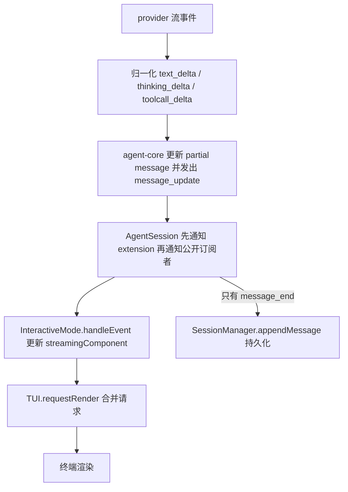
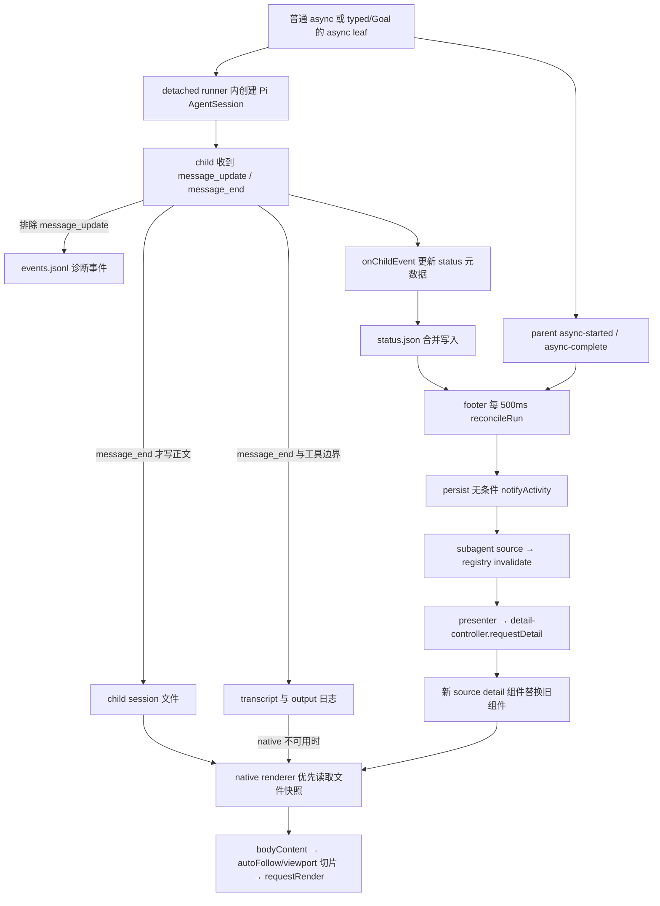

结论：从当前源码看，本地 Pi subagent 的模型执行使用流式事件，但后台详情主要读取只在消息结束时更新的 session/transcript，再经 500ms 轮询刷新，因此详情呈现的是“按消息分批更新”，不能据此认定模型/API 改成了非流式。

**调查范围与证据口径**

本报告只分析源码并设计修复方向；未启动 provider、child、真实 Host 或业务验证，未读取凭据、实际 session 内容或运行产物。基线 HEAD 为 `633a2af2c43ae4dbbe9a2dc1d88937d39353622a`，以调查时工作树为准，不能把行号等同于该提交的内容：`presenter.ts`、`detail-controller.ts`、typed extension、root broker 等已有其他工作的未提交变更，本调查没有改动它们。

现场安装版本：`@earendil-works/pi-coding-agent`、`pi-agent-core`、`pi-ai`、`pi-tui` 均为 `1.4.0`，`pi-subagents` 为 `0.80.0`。版本依据分别为对应 `package.json:3`，以及 `packages/pi-subagents-enhanced/node_modules/pi-subagents/package.json:4`。下文行号均指这些现场文件，不依赖旧注释所写版本。

为使长路径可读，引用使用以下确定前缀；例如 `H/core/agent-session.js:755` 精确表示 `node_modules/@earendil-works/pi-coding-agent/dist/core/agent-session.js:755`。

| 前缀 | 仓库相对路径 |
| --- | --- |
| `H/` | `node_modules/@earendil-works/pi-coding-agent/dist/` |
| `A/` | `node_modules/@earendil-works/pi-agent-core/dist/` |
| `I/` | `node_modules/@earendil-works/pi-ai/dist/` |
| `T/` | `node_modules/@earendil-works/pi-tui/dist/` |
| `U/` | `packages/pi-subagents-enhanced/node_modules/pi-subagents/src/` |
| `P/` | `packages/pi-subagents-enhanced/src/` |
| `R/` | `src/background-activity/` |

“流式”需要分三层理解：provider 是否持续交付增量；child 是否持续接收 `message_update`；parent 详情是否消费这些增量。源码证明后两层目前并未连通，不能用详情的观感反推第一层。这里的 token 级指 `text_delta` / `thinking_delta` 等增量粒度，并不保证一次事件恰好是一个模型 token。

**调用链一：主会话从 provider 到终端**

1. SDK 构造 Agent 的 `streamFn` 调用 `modelRuntime.streamSimple`：`H/core/sdk.js:252`、`:261`、`:271`。runtime 调用选中 provider 的 `streamSimple`，不是先等待 `completeSimple().result()` 再送给 UI：`H/core/model-runtime.js:497`、`:521`、`:524`。
2. 以已安装的 OpenAI Responses 实现为具体例子，请求包含 `stream: true`（`I/api/openai-responses.js:266`）；`processResponsesStream` 对 provider 事件 `for await`，`response.reasoning_text.delta` / `response.output_text.delta` 分别转换为 `thinking_delta` / `text_delta`（`I/api/openai-responses-shared.js:543`、`:575`、`:587`）。SDK 的 `provider_stream_event` hook 在归一化前观察 parsed event（`H/core/sdk.js:240`）。这是受支持实现的证据，不是对本次用户实际 provider 的识别。
3. `streamAssistantResponse` 遍历 response，遇到 text/thinking/toolcall 的 start/delta/end 更新 partial，并发出 `message_update`；遇到 done/error 才发 `message_end`：`A/agent-loop.js:265`、`:286`、`:294`、`:307`、`:325`。
4. AgentSession 构造时订阅 agent（`H/core/agent-session.js:202`）；事件处理先 `await _emitExtensionEvent(event)`，再 `_emit(event)`，公开 listeners 因而能看到尚未落盘的 partial（`:708`、`:752`、`:753`）。extension 如果耗时会影响消费顺序，但本调查没有耗时证据，不把它归为此次主因。
5. `InteractiveMode.subscribeToAgent()` 直接订阅 session（`H/modes/interactive/interactive-mode.js:2698`）。`message_start` 创建 streaming component；`message_update` 更新 `streamingMessage`、调用 `streamingComponent.updateContent(..., true)` 并 `ui.requestRender()`（`:2796`、`:2804`、`:2807`、`:2828`）。`AssistantMessageComponent.updateContent` 重建当前消息内容，没有等待若干字符的门槛（`H/modes/interactive/components/assistant-message.js:69`）。
6. `TuiBase.requestRender()` 经 nextTick 合并，常规帧间隔为 16ms，再调用 `doRender()`（`T/tui.js:193`、`:658`、`:693`）。fullscreen 路径最终写 terminal（`T/tui-alt-screen.js:1449`、`:1553`）。所以“即时”也受帧合并、extension 和渲染成本影响，但不是等待整条消息结束。

**调用链二：subagent 从 child 到统一详情**

1. 普通 async 启动 detached runner，stdout/stderr 指向日志 fd 或 ignore，并没有把 stdout pipe 作为 parent 的 token 流：`U/runs/background/async-execution.js:483`、`:518`、`:521`。它发出 `subagent:async-started` 并立即返回 run handle（`:1502`、`:1540`；single 分支在 `:2091`）。默认 runner factory 通过 Host peer alias 使用安装的 Pi SDK（`U/runs/background/runner-child-sessions.js:10`、`:25`）。
2. 本地 child factory 调 `createAgentSession`（`U/runs/shared/child-session.js:478`），对外 `subscribe` / `prompt` 直接代理 Pi session（`:555`）；`runChildSession` 在 `created.prompt` 之前 `created.subscribe(processEvent)`（`U/runs/background/run-child-session.js:589`、`:618`）。`bindExtensions({mode: "print"})` 仅说明 child 无交互 TUI，不代表模型非流式（`U/runs/shared/child-session.js:497`）。
3. `processEvent(raw)` 确实接收增量，先交 `partialOutput.observe(raw)`，然后走诊断 log、transcript 和 `onChildEvent` 分支（`U/runs/background/run-child-session.js:304`、`:307`、`:309`、`:310`、`:360`）。但 native session 正文由 Pi 的 `message_end` 持久化，诊断 log 明确过滤 `message_update`，transcript 只写消息完成与工具边界；具体首偏离点见后表。
4. runner 的 `onChildEvent` 接到 `updateStepFromChildEvent`（`U/runs/background/subagent-runner.js:4333`；parallel 在 `:3601`）。每个事件仍可推动 `lastActivityAt/lastUpdate`，`message_end` 才将 assistant 正文放入 recent output（`:2760`、`:2914`、`:2952`）；status 合并写入为 100ms（`:1915`、`:1923`）。因此“活动时间还在动、正文没动”与源码一致；status 不是 partial 正文载体。
5. parent 的统一详情 owner 位于 `P/tui/footer-runtime.ts`。它只直接订阅 `subagent:async-started`、`subagent:async-complete`（`:993`），此外固定 500ms `reconcile`（`:1008`）。`reconcile` 逐个 tracked run 读 `status.json`，更新 browser，随后无条件 `persist()` / `refresh()`（`:520`）。文件读取入口为 `P/tui/browser-adapter.ts:15`；browser 读取 step 的 `sessionFile` 和 `transcriptPath`（`P/tui/session-browser.ts:263`、`:302`、`:322`）。
6. `persist()` 保存 roster 后无条件 `notifyActivity()`（`P/tui/footer-runtime.ts:478`、`:483`、`:493`）。因此不是“状态没改变就不刷新”。当代 source 的订阅接线在同文件 `:985`；`P/tui/subagent-activity.ts:132` 转发失效；registry 对当前注册 handle 检查后通知 listeners（`P/tui/background-activity.ts:291`、`:357`、`:366`）。
7. `R/presenter.ts:245` 的 registry listener 调 `shell.handleRegistryInvalidated()`，刷新 footer。controller 即使 key 不变也重新 `requestDetail()`（`R/detail-controller.ts:355`、`:367`），通过 `source.detail(key, {expanded, requestRender})` 取得组件（`:692`、`:714`、`:719`），promise 成功后 dispose 旧组件并替换（`:734`、`:747`）。这不是每次重新挂 overlay；`ctx.ui.custom` 的壳仍保留。
8. source detail 组件按 width 缓存渲染结果（`P/tui/subagent-activity.ts:149`、`:156`、`:160`）。渲染进入 `renderChildByKey → renderChild`（`P/tui/footer-runtime.ts:565`、`:532`），优先 native session，native 有正文或无 warning 就返回；只有 native 失败/缺失等条件下才读 Fleet transcript（`:535`、`:549`、`:551`）。二者不是 live delta 与 session 的合并视图。
9. native renderer 按文件 `dev:ino:size:mtimeMs` 与 width、主题、展开状态等缓存（`P/tui/native-conversation.ts:120`、`:131`、`:179`）。指纹变化后复制文件到安全临时快照，`SessionManager.open(snapshot).buildContextEntries()`，重建 conversation 组件（`:139`、`:143`、`:186`、`:217`、`:254`）。未结束的 assistant message 尚不在文件中，再频繁读取也不会出现。
10. `R/detail-controller.ts:903` 的 `bodyContent()` 每次调用 `component.render(width)`；随后 `renderBodyLines()` 按 autoFollow / 手动 anchor 切片（`:888`）。`settleSuccess` 和回调请求 overlay TUI 重绘（`:756`、`:865`；`R/presenter.ts:393`）。最终与主会话共用 TUI 的帧合并机制。

接线补充：`R/index.ts:10` 只是 package 协议和 renderer 的公开导出，没有额外计时器；`pi/extensions/background-activity.ts:29` 从这里导入 presenter 并通过 owner-ready/presenter-register 握手（`:102`）。唯一 Alt+O 入口在 `packages/pi-subagents-enhanced/extensions/custom-footer.ts:21`；owner 直接把 subagent source 注册进 registry（`P/tui/footer-runtime.ts:812`）。无需假定还有一条隐藏的主会话 `message_update → subagent detail` 接线。

**首个把增量转成粗粒度事实的位置**

| 消费路径 | 首个边界与精确证据 | 影响 |
| --- | --- | --- |
| 默认 native session 详情 | `node_modules/@earendil-works/pi-coding-agent/dist/core/agent-session.js:755` 仅在 `message_end` 分支调用 `appendMessage`（`:767`）；`H/core/session-manager.js:827` → `:819` → `:794` 写文件 | 模型仍在产生 text/thinking delta 时，文件没有该条 assistant 正文；等一条消息完成后才整块出现。不是等待整个 run 完成。 |
| async `events.jsonl` | `packages/pi-subagents-enhanced/node_modules/pi-subagents/src/runs/background/run-child-session.js:16` 的 `shouldPersistChildEvent` 返回 `event.type !== "message_update"`，在 `:150` 提前 return | 已收到的流事件被明确排除出诊断 log；直接 watch 此文件也拿不到这些 delta。 |
| 备用 transcript | `packages/pi-subagents-enhanced/node_modules/pi-subagents/src/shared/child-transcript.js:179` 的 `writeChildEvent` 只处理 `message_end`、`tool_execution_start/end` | Fleet 回退也按消息/工具边界更新，不是可替代的 token 流。 |
| async 文本 output log | `U/runs/background/run-child-session.js:380` 在 `message_end` 才 `writeOutputText`，工具启动在 `:377` 写一行；由 `U/runs/background/subagent-runner.js:910` append 到 outputFile | output 日志能在 run 进行中分段追加，但没有逐字正文；统一 native 详情也没有从该日志补 partial。 |
| bash_async | `src/bash-async/controller.ts:65` 明确不转发 onUpdate，`:69` 等待 `prepared.execute` 返回完整结果 | 对该 source，运行期间没有 stdout 正文观察面，只有命令完成后的一次输出。与模型流无关。 |

`projectChildSessionEventForJson` 去掉 partial 快照但保留 `assistantMessageEvent` 的 delta（`U/runs/shared/child-session.js:27`）。所以它本身不是“把 delta 变成最终结果”的位置；真正丢掉事件的是后面的诊断过滤和 transcript 选择。不能把格式投影与流式丢失混为一谈。

对 native 详情中的某个增量，可见延迟大致由“等当前 message_end 的剩余时间 + 下一次 500ms 轮询等待 + 文件/渲染成本 + TUI 帧合并”组成。500ms 是轮询目标周期，不是包含事件循环阻塞在内的严格上界；100ms status 合并主要影响元数据和路径发现，不应机械地与其他 watcher 参数全部相加。长思考或长回复期间，第一项可能远大于 500ms。

**轮询、节流、缓存与交互逐项核对**

| 因素 | 当前实现 | 是否能解释正文迟到 |
| --- | --- | --- |
| footer 轮询 | `P/tui/footer-runtime.ts:1008` 固定 500ms，session_start 创建，`:602` 清理；即使状态未变也 notify | 已落盘内容再等一次轮询；不能产生未落盘 delta。 |
| runner status 合并 | `U/runs/background/subagent-runner.js:1923` 为 100ms；状态转换/非 running 可立即 flush。`U/shared/file-coalescer.js:8` 已 pending 时不重置 timer | 是有界合并窗口，不是不断被新 token 延长的 trailing debounce；status 只有活动元数据与完成消息摘要。 |
| upstream tracker watcher | `U/runs/background/async-job-tracker.js:633` watch asyncDir、status、events；`:23` 25ms 合并；`:22` 默认 5000ms liveness；`:24` 挂载重试 100ms | 这是 upstream job/widget/control 观察链，footer 的 500ms 是另一套直接文件读取；不能把 5 秒说成统一详情刷新周期。 |
| upstream 完成 watcher | `U/runs/background/result-watcher.js:581` 合并 result 文件，默认 50ms（`:587`）；fallback poll 3000ms、健康补扫 60000ms（`:15`、`:16`、`:707`、`:772`） | 影响完成结果发现/通知；`async-complete` 在接受投递之后发出（`:505`、`:532`），不提供持续正文流。运行态详情仍可经 500ms 路径刷新。 |
| root broker artifact poll | `P/subagent-dispatch/root-broker-server.ts:287` 默认 50ms，`:880` 轮询官方 terminal artifact | 是终态证明等待，不是 token 或详情文本刷新。 |
| source width 缓存 | `P/tui/subagent-activity.ts:156` 缓存 `{width, lines}`；同宽 `render()` 不再读文件；`:165` invalidate 清空并 requestRender | 单纯 requestRender、滚动通常只重绘旧行。当前每次 registry invalidation 会换新组件，所以正常 500ms 路径会打破此缓存。 |
| native 文件指纹缓存 | `P/tui/native-conversation.ts:131`、`:179`；每文件至多 16 个渲染 variant（`:155`） | 指纹变化就重读，不是固定秒数 TTL。消息尚未落盘，缓存命中反映的是数据源没变。 |
| 完整重建成本 | controller 换 detail 组件；native 文件变化时复制/解析整个快照并构建组件（`R/detail-controller.ts:747`；`P/tui/native-conversation.ts:139`、`:186`、`:217`） | 可能扩大长 transcript 的同步 CPU/IO 成本，但未测量，不能断言是当前主要耗时。主会话也会重建当前消息内容，差异在数据源和重建范围。 |
| request fence | `R/detail-controller.ts:692`、`:734`：record 身份代表 scope/source/key/sequence；过期结果 dispose，不覆盖当前组件 | 没有定时等待。若 source.detail 很慢、失效非常密集，旧请求可能一直被废弃；当前 subagent detail 只是创建 wrapper，没有跨 await 文件 IO（`P/tui/subagent-activity.ts:149`），未发现这类实际饥饿证据。 |
| bodyContent 缓存 | `R/detail-controller.ts:903` 正常每次 `component.render(width)`；`:913` 保存上次行，`:921` 仅异常/无效返回时回用；换组件清空（`:751`） | 现场没有“正文只首次计算”的缓存门禁，也没有最小新增字符阈值。主要缓存位于 source/native 层。 |
| autoFollow | 默认 true（`R/detail-controller.ts:269`）；上滚/Home 可进入手动 anchor（`:823`、`:849`），End 恢复（`:857`） | 内容可已更新但尾部在视口外；这是假象来源之一，不会阻止抓取。不能据此证明用户此次已关闭跟随。 |
| 打开、展开、输入 | open 请求详情（`R/detail-controller.ts:307`）；x 重取（`:684`）；换选项重取（`:667`）；主题重取（`:371`）；滚动只请求 render | 详情不依赖用户按键才刷新。x 可能让已落盘内容提前被看到，但仍不能读取尚未持久化的正文。 |
| TUI 帧合并 | `T/tui.js:193`、`:693` 16ms，主会话与详情共用 | 不是详情独有的秒级节流。 |

registry 的任意 source 失效都会让当前选中详情重取（`R/presenter.ts:245`），没有按“该选中行是否变化”过滤；因此 subagent 的 500ms tick 也可能重建当前选中的其他 source 详情。它解释了额外重建，不代表那些 source 本身能流出正文。

**普通 async、typed/Goal、bash_async 的真实差别**

| 来源 | 执行/parent 感知链 | 详情正文链与结论 |
| --- | --- | --- |
| 普通本地 Pi async | detached runner → Pi child session；parent 收到 async-started/complete，另读 status/artifacts | native session / Fleet transcript 共同按消息边界持久化；500ms 观察。child 流式，详情没有逐增量消费。 |
| typed subagent / Goal 执行 | `P/subagent-dispatch/extension.ts:1141` 的 coding dispatch 调 `spawnWorkflowLeaf`，`:706` 调 `rpc.spawn`；`P/subagent-dispatch/workflow-spawn.ts:89` 的 leaf 和 `:98` 的 workflow root 都 `async: true` | typed 入口不是另一种非流式模型调用。browser 经 `parentWorkflowRunId/workflowKey/facadeLeafRunId` 关联并折叠 root/leaf（`P/tui/session-browser.ts:269`、`:315`、`:415`），仍由同一 subagent source 读取 leaf 文件。 |
| 当前 Goal runtime 的事实更新 | PlanExecutionService.start 复用 `executeCoding`（`P/subagent-dispatch/extension.ts:2188`）；Host 将 subscribe 绑定 broker execution facts（`packages/pi-subagents-enhanced/extensions/subagent-runtime.ts:497`）；Goal `execution.subscribe → reconcile → refreshRuns`（`src/goal-runtime/index.ts:226`、`:249`、`:257`） | 这是 run/工作区/集成/终态事实的刷新，Goal 本身没有在这条链提供 ActivitySource token 正文；不能将 Goal reconcile 与 detail-controller 的 500ms 轮询当作同一个机制。 |
| bash_async | controller accept/terminal/reset 等触发内存失效订阅；执行时不给原生 tool onUpdate（`src/bash-async/controller.ts:64`、`:69`、`:92`、`:100`） | `src/bash-async/index.ts:239` 订阅 controller，`:240` detail 每次创建静态 Text；active 只显示 launch 信息（`:156`），terminal 才显示原生 output（`:195`）。没有运行中 stdout 流，也没有 source 自己的轮询。 |

root broker 的 `subscribe` 名称不意味着文本 streaming：它订阅 child 的控制通知，激活时发 `subscription.ready`（`P/subagent-dispatch/root-broker-server.ts:1315`），恢复事件为 `recovery.event`（`:1281`）。`subscribeExecutionFacts` 只通知 runId，并在 microtask 内按 run 去重（`:205`、`:210`），触发点包括 terminal proof 接受/投递/lease 释放（`:742`、`:778`、`:800`、`:813`）。其直接事件订阅是 async-started 与 process-terminal（`:339`），没有把 child `message_update` 送给统一详情的接线。

范围限制：以上模型判断针对源码中的默认本地 Pi child 路径。`U/runs/shared/child-session.js:610` 的 placement factory 在 `launch.machine` 存在时可转入远端实现；runner 也存在 external engine 分支。本调查未确认用户具体 run 的 provider、engine、placement 或是否实际启用统一 presenter，不对这些未识别来源作网络流式承诺。fallback standalone browser 仍共用 `renderChild` 和 500ms reconcile（`P/tui/footer-runtime.ts:630`、`:1008`），因此“消息持久化边界”的主结论不依赖 unified overlay 是否成功挂载。

**可复用的事件，以及最小修复选项（只设计，按收益与风险排序）**

1. **优先恢复进行中消息的显示通路，收益最高，改动风险中等。** 在已经收到 `message_update` 的 child 观察点（`U/runs/background/run-child-session.js:304`、`:360`）复用 `text_delta/thinking_delta/toolcall_delta` 及 `message_start/message_end`，增加窄的只读 parent 观察传输，接到现有 `ActivitySource` 和 `DetailRequest.requestRender`（`P/tui/background-activity.ts:58`、`:65`）。native 已完成消息照旧使用 session 权威；进行中消息作为独立显示投影，message_end 后替换/去重。复用现有 run/child/session 身份和 fence，不新建任务状态机、不改变 completion/terminal proof，不把 partial 写成正式 session message，也不改模型实际收到的 payload。跨进程传输现在缺失，不能只在 root presenter 订阅 parent `message_update` 就声称解决；parent 那个事件属于主会话。可优先采用受支持的 child extension 消息观察与现有传输扩展点，具体传输方案需单独评审，不能把控制 broker 当作已经存在的文本通道。
2. **缩短已落盘内容的发现时间，收益有限、风险较低。** 复用已有文件 watch/coalescer 的机制，在受信 session/transcript 文件变化时触发 source invalidation，保留低频 reconcile 兜底。现有 async-started/complete、child-status/control 等事件可用于任务状态和文件定位刷新，但它们不携带正文 delta（`U/runs/background/async-job-tracker.js:280`、`:328`），不能冒充文本事件。仅将 500ms 改小可做很小 diff，但只减少轮询等待并增加同步读取负担，无法解决长消息期间整段空窗。
3. **减少无关 invalidation 和整组件重建，收益取决于性能数据、风险较低至中等。** 复用 `DetailComponent.invalidate()`、source subscribe 和 requestRender，保留同 source/key 的组件，只在所选正文/元数据确实变化时清缓存；选择、展开、主题、source 替换仍沿现有 request fence。必须同时清掉 source width 缓存；只调用 requestRender 仍返回旧行。native 文件指纹缓存可以保留。当前 bodyContent 已每帧 render，不能再把它改成仅组件身份/宽度缓存，否则会阻断以后同组件内的实时更新。该优化应在测量长会话文件复制/解析耗时后决定，不能替代第一项。
4. **bash_async 的运行中输出单独立项，不能顺带当 subagent 修复。** 若需要该能力，在原生执行的 onUpdate 观察点保留独立显示投影并触发已有 controller.subscribe；最终回执和发送出口仍只认完整结果。当前 source 明确只支持 launch/terminal，这属于新增展示能力，收益与 subagent 推理流无直接关系。

不存在能通过“删掉一个节流参数”同时修复全部来源的证据。最小有效的 subagent 流式修复必须跨过 child 到 parent 丢失增量的边界；仅优化 footer、viewport 或刷新频率只能改善已存在正文的呈现。

**验证记录与剩余不确定性**

- 已用只读源码逐段对照两条链，并核对现场版本、HEAD、Git index；未读取任何真实 run/session 内容。搜索中曾尝试不存在的根 `node_modules/pi-subagents` 和旧 provider 路径，随后定位到 package 内安装的 `pi-subagents` 及 `pi-ai/dist/api`；未以缺失路径作任何归因。
- 文档引用校验已通过：77 个带路径的源码引用全部存在且行号有效，并抽查对应代码内容；报告为唯一写入文件，Git index 无 staged 文件。没有新增/修改测试。此项仅文档调查，不运行 UI 单测、真实 provider 或实际业务；静态源码证据不能冒充端到端延迟实测。
- 已有 UI 测试 `test/background-activity-details.test.mjs:758`、`:769` 覆盖 invalidate 重取和 source 替换，`:795` 覆盖主题重取；本调查只阅读，未重跑，不声明测试通过。
- 未测量实际 token 到达时间、message_end 时间、文件大小、event-loop 阻塞、cache 命中或用户滚动位置。无法判断用户感知延迟中各项的实际占比，无法确认特定自定义 provider 是否缓存网络输出；这些不能从源码推出。
- 在后续获授权的性能验证中，可沿现有事件记录单调时间点：child message_update/message_end、文件更新、parent invalidate、detail settle、viewport render。只记录身份与时间即可判断“消息边界等待”与“渲染耗时”，无需收集正文或构建新的调度状态机。本报告未实施该探针。

**追加调查：child extension 能干预什么，哪些边界由 Pi / pi-subagents 持有**

结论：**child extension 可以通过公开 `pi.on("message_update")` 观察累计 partial 和 delta，也可以观察消息结束及 session 生命周期；但它不能通过现有公开 extension API 改写 pi-subagents 的诊断/transcript 过滤策略，更不会自动将事件送给 parent 详情。** 因而不是“全部由 pi-subagents 控制”，也不是“加一个事件监听即可完成流式详情”：观察点已经开放，跨进程显示传输和 parent 消费仍需实现。Pi core 持有正式消息的持久化时机，pi-subagents 持有 runner 产物及事件出口，enhanced 持有详情投影。以下只追加设计与静态证据，不改变此前报告正文。

本节继续使用前述 `H/`、`U/`、`P/`、`R/` 前缀，增加 `D/` = `node_modules/@earendil-works/pi-coding-agent/docs/`，`E/` = `node_modules/@earendil-works/pi-coding-agent/examples/`。官方文档以现场 Pi `1.4.0` 安装包为准，已完整阅读 `D/extensions.md` 及直接相关的 SDK、CLI、JSON、RPC、RPC UI、消息、session 格式和 package 文档，并对照示例及已安装源码。未打开原调查 run 的 session 文件；“沿用原 session 背景”指保留前次调查上下文，不将实际运行产物作为本节证据。

**一、公开事件能力：print、model-only 都不是“没有增量事件”**

| 能力 | 官方文档与现场源码 | 对本任务的含义 |
| --- | --- | --- |
| 观察增量 | `D/extensions.md:119` 列出 message lifecycle；`H/core/extensions/types.d.ts:843` 的 `MessageUpdateEvent` 包含 `message: AgentMessage` 与 `assistantMessageEvent: AssistantMessageEvent`；`:1217` 声明 `pi.on("message_update", handler)` | SDK 内的 extension 可同时看到累计消息与 text/thinking/toolcall 的增量，适合产生独立显示投影，不必从日志反推。 |
| 真实转发路径 | `H/core/agent-session.js:927` 将两字段原样交给 extension runner；`:752` 等待 extension，再于 `:753` 通知公开 session subscribers | extension 的观察点早于 runner 的 session subscriber / artifact 过滤。handler 应快速复制需要的数据并入队，不能每个 delta 都等待网络或同步写大文件；否则会拖慢模型事件消费。`D/extensions.md:214`、`:224` 明确提示慢 handler 的影响。 |
| 消息开始、结束和 session 事件 | `H/core/extensions/types.d.ts:837`、`:849`；`D/extensions.md:127` 的 session 生命周期；child factory 在 `U/runs/shared/child-session.js:489` 指定 `session_start`，`:418` 发 `session_shutdown` | 可以初始化观察器、分配本地消息序号、结束/清理投影。shutdown 在异常进程退出时不能视为必达，显示层仍需沿已有 run/session fence 清理。 |
| `message_end` 的真实修改能力 | `D/extensions.md:218` 明确允许返回同 role 的最终消息；`H/core/extensions/types.d.ts:1121`、`:1218`；`H/core/extensions/runner.js:864` 链式处理 replacement 并校验 role；`H/core/agent-session.js:940` 接受后调用原地替换 | 不能笼统宣称 extension 完全不能修改 session 消息。此接口会影响最终 agent state、后续 listeners 和持久化（`H/core/agent-session.js:883`），不是纯 UI 功能；为了详情流式不应使用它改正文。 |
| print 与无 UI | `D/extensions.md:363` 明确四种模式都加载 extensions，print/JSON 无 UI；`D/cli-integration.md:5` 表明共用 agent/session/resources；`U/runs/shared/child-session.js:497` 使用 `bindExtensions({mode: "print"})` | “print stdout 仅最终结果”是 CLI 输出选择（`D/cli-integration.md:28`），不是内部没有 `message_update`。当前 detached child 是 SDK session，不是在运行一个自动输出 JSON/RPC 的 Pi CLI。 |
| model-only | `D/extensions.md:270` 的 tool exposure 规则；`U/shared/extension-context.js:7` 为 `{exposure: "model-only"}`；`U/intercom/native-supervisor-channel.js:197` 将其用于 contact_supervisor 工具声明 | 它限制工具从哪里被调用，不关闭 extension 事件。不能把 model-only 工具的可调用性与 session streaming 混为一谈。 |

官方 SDK 示例 `E/sdk/01-minimal.ts` 和 `D/sdk.md:72` 直接订阅 `session.subscribe` 的 `text_delta`；`E/sdk/06-extensions.ts:26` 演示显式文件路径与 inline factories 的资源加载。`provider_stream_event` 也可观察归一化前的 provider parsed event（`D/extensions.md:222`；`E/extensions/debug-provider.ts`），但详情应优先使用规范化 message 事件，以免耦合具体 provider；该 hook 不保证拿到原始 HTTP 字节，也不能据此承诺所有 provider 都持续发出增量。

SDK 与 wire 的 partial 还必须区分：`D/json.md:72` 规定 JSON/RPC 的 `message_update` 只携带 delta、去掉累计 message/partial；`U/runs/shared/child-session.js:27` 做相同方向的投影。extension 在此投影前获得 SDK 事件。新显示传输可复用这种 delta 形状与 `message_end` 最终替换规则（`D/json.md:93`），但不能宣称该上游 helper 与官方 wire 的所有字段完全一致，例如当前 helper 只是去掉 partial，并不补官方 toolcall-start 投影的所有元数据。

**二、本仓显式注入到 detached child 的完整链**

1. 主入口只发现 package manifest 声明的 `extensions/subagent-runtime.ts` 与 `extensions/custom-footer.ts`，没有自动扫描 `child-extensions/`（`packages/pi-subagents-enhanced/package.json:19`）。`packages/pi-subagents-enhanced/extensions/subagent-runtime.ts:243` 遇到 child 标记直接返回，避免主 runtime 在 child 中重复安装；这不妨碍另行显式加载 child 专用入口。
2. `P/subagent-dispatch/extension.ts:618` 定义 root-owner、acceptance、integration 的绝对入口。主 session 初始化时用 **`ctx.sessionManager.getSessionId()`** 为键调用公开 `registerRequiredChildExtensions`（`:2585`、`:2591`），同一数组注册 root-session-owner、integration-queue、可选 agents-shared。`U/shared/required-child-extensions.js:60` 禁止同 session 重复注册；`:76` 按 session ID 查找。注册键是 session ID，不是 session 文件路径。
3. async launch 解析 registry / 显式参数 / inherited runtime，并将所选 required 扩展带入 step（single：`U/runs/background/async-execution.js:1614`、`:1783`、`:1935`；workflow：`:975`、`:1035`）。`U/runs/background/runner-child-launch.js:32` 把 `step.extensions`、`subagentOnlyExtensions`、`requiredExtensions` 交 `buildInProcessChildLaunch`；`:40` 带入规范化 `extensionBindings`。后者是配置数据，不是事件通道，也不同于 SDK 方法 `bindExtensions`。
4. `U/runs/shared/child-launch.js:78` 解析 required；`:86` 调 tool plan；`U/runs/shared/child-tool-plan.js:273` 区分 ambient 和显式 extensions，`:300` 将 required 路径最终合入并去重，required 与 `denyExtensions` 冲突会在 `:175` 报错。`extensions: []` 禁用 ambient，并不删除 required；普通 `subagentOnlyExtensions` 则仍受 capability ceiling 控制。`U/runs/shared/child-launch.js:199` 仅 runner 默认继承 ambient，foreground 不继承该集合。
5. `U/runs/shared/child-session.js:397` 构造 `DefaultResourceLoader`，`:408` 使用 `additionalExtensionPaths: launch.extensionPaths`，`:409` 加入上游 `launch.hooks` 等 inline factories。`:439` 应用 runner 配置环境，`:442` reload，required 加载错误会失败；`:478` 创建 SDK session，再在 `:497` 执行 `bindExtensions({mode: "print", onError})`，收集 required 启动错误（`:512`）。**bindExtensions 负责连接已加载的 extension runtime 并启动生命周期，不负责把 parent 上的 extension 实例复制进 child，也不提供 parent 事件转发。**
6. 返回的 child `subscribe` 代理 SDK（`U/runs/shared/child-session.js:555`）；runner 在 prompt 前订阅（`U/runs/background/run-child-session.js:589`、`:618`）。因此扩展观察与 runner 消费同一 child 的事件，二者不是互斥选择。

| 本仓入口 | 确定的注入条件 | 加载后的作用与限制 |
| --- | --- | --- |
| `child-extensions/root-session-owner.ts` | 上述主 session required 注册成功，launch 选择该快照且走本地 native Pi 路径 | `:26` 在 session_start 解析 bindings，`:38` 在取得 client 时才发本地 ready；`:53` 起有 broker marker / 身份缺失分支。加载成功或 acknowledgement 不证明 broker 已连接。 |
| `child-extensions/integration-queue.ts` | 同一 required 注册；coding worktree 分支也通过 subagentOnlyExtensions 显式追加（`P/subagent-dispatch/extension.ts:636`） | `:179` 起解析绑定；`:185` 起无完整 broker 身份的 generic child 可仅确认加载；具备身份时才装配 integration 能力。它不是通用正文转发器。 |
| `child-extensions/acceptance-evidence.ts` | coding dispatch 有 `goalTicket` 时加入 subagentOnlyExtensions（`P/subagent-dispatch/extension.ts:638`） | `:92` 起有身份才创建 `acceptance.submit` client；不是每个普通 async 都会注入，也不是 required 数组成员。 |
| `pi/extensions/agents-shared.ts` | 主入口从可信 `PI_CODING_AGENT_DIR` 生成路径并传 `requiredSharedChildExtension`（`packages/pi-subagents-enhanced/extensions/subagent-runtime.ts:248`、`:416`） | 入口 `:9` 按 child 标记选择共享指令 scope。它不位于 package child-extensions 目录，但确实在显式 required 链中。 |

这里的“确定”是启动代码的条件结论，不是本次实际 run 的加载证明：本调查未读 `runtimeAcknowledgedExtensions` 等运行产物。还必须保留 runner 差异：本仓注册没有设置顶层 `requireForAllRunners`；上游 external runner 会取空 required（`U/runs/background/async-execution.js:1783`），`U/shared/required-child-extensions.js:81` 只有强制 flag 才拒绝不支持的 external/machine 路由。不能因文件位于 child-extensions，就断言远端或外部引擎也运行了它们。

**三、通信边界：哪些可复用，哪些不是文本 bridge**

| 机制 | 当前证据与进程边界 | 可复用判断 |
| --- | --- | --- |
| `pi.on` 与 `pi.events` | 前者接收当前 session lifecycle；后者由 `H/core/event-bus.js:1` 的 Node EventEmitter 实现，loader `H/core/extensions/loader.js:420` 包装 emit/on | `pi.events` 只在同一个 event bus 实例中通信，detached child 与 parent 不共享内存。可以用于 child 内部 producer→sender、parent 内部 receiver→source；仅同名 emit/on 不能跨进程。 |
| 上游公开 event-bus RPC / delegation | `packages/pi-subagents-enhanced/node_modules/pi-subagents/docs/extension-api.md:96` 定义 process-local RPC，`:170` 明确不跨 child 进程；`:354` 定义 foreground delegation update 为有界进度快照 | 可复用 spawn/status/完成关联及稳定 run/index；该 RPC 不是 Pi CLI RPC。foreground 进度快照也不是 detached child 的原始 text delta bridge，不能把两类 RPC 或 snapshot/delta 混用。 |
| runtime acknowledgement | child 发 `subagent:acknowledge-extension`；`U/runs/shared/subagent-prompt-runtime.js:58` 收集，在 agent_end/shutdown finalize；`U/runs/shared/child-hooks.js:126` 捕获；`U/runs/background/subagent-runner.js:949`、`:1056` 写进结果 | 这是上游明确接线的有限 bridge，证明“本地事件可经 runner 专门转接”，但只投影扩展 ID，不是任意 payload 或连续正文出口，不能借 ID 字段传 delta。 |
| `ctx.ui.notify` / widget | print 的默认 UI 是 no-op（`H/core/extensions/runner.js:133`）；RPC UI 才转成 stdout 的 `extension_ui_request`（`D/rpc-extension-ui.md:3`） | 当前 SDK child 没有 RPC UI adapter，notify 不会通知 parent。`E/extensions/rpc-demo.ts` 展示的是 RPC 的能力，不能直接移植来宣称 detached SDK 已具备 bridge。 |
| JSON / RPC stdout | 官方 `D/cli-integration.md:34`、`:54` 和 `D/rpc.md:22` 支持跨进程事件；`E/rpc-client.ts:20` 消费 `text_delta`；当前 detach spawn stdout/stderr 是 fd / ignore（`U/runs/background/async-execution.js:518`） | 官方存在受支持的进程流协议，但当前 runner 没有启动该 CLI 或消费其 stdout。改为 RpcClient 属于执行适配层变更，涉及 prompt/control/取消/session 生命周期，不是仅换 extension mode 的最小修复。禁止把 console.log 混进既有日志当可靠事件通道；JSON/RPC 若采用必须遵守严格 LF JSONL 和背压规则（`D/json.md:13`）。 |
| native supervisor 通道 | `U/intercom/native-supervisor-channel.js:130` 构造 request，`:156` 原子写请求文件；progress 不等回复；parent 在 `:765` 遇 progress 清理，在 `:779` 对决策请求 `sendMessage(..., {triggerTurn: true})` | 是真实跨进程业务桥，服务 ask/reply/progress。它不是 observer API；连续 delta 填 progress 不会自动渲染详情，填 ask 则会改变 parent 对话/模型调度。公开 `intercom-bridge` 导出仅为 target resolver（`U/api/intercom-bridge.d.ts:1`），不是通用 streaming sink。 |
| 本仓 root broker | `P/subagent-dispatch/root-broker-client.ts:154`、`:191` 建立 socket；`P/subagent-dispatch/root-broker-protocol.ts:16`、`:18` 枚举方法/capability，`:382` 拒绝未知 method | 已有经过身份验证的跨进程业务连接，可复用连接/身份设计，但现协议没有 partial.publish 或正文订阅。acceptance、coordinator、lease/recovery 各有语义，不能塞入 delta。增加窄的显示协议是本仓可做的工作，仍是新增传输能力，需明确 admission 和生命周期。 |

`P/subagent-dispatch/child-broker-binding.ts:7` 的 locator 经 child 标记、workspace、process birth、current receipt、lease、grant 核验后才成为身份。已有 `extensionBindings['pi-config.root/1']` 仅给定位信息，不能把该字符串视为授权。普通 generic async 可能没有该 broker 身份，因此“复用 root broker”并不自动覆盖全部 async；覆盖范围应跟随已有可靠身份，不能为显示功能放宽 owner/grant 校验。`pi.sendMessage`/`pi.sendUserMessage` 操作所在 session，并不是向 parent 发事件；官方 `D/extensions.md:345` 也明确 custom message 会进入模型上下文。独立显示应避开这些出口。

**四、持久化所有权与 extension 能力的安全边界**

- **Pi core 正式 session：** `H/core/agent-session.js:752` → extension → public subscribers → `:755` 的 message_end 分支 → `:767` 的 `SessionManager.appendMessage`。`H/core/session-manager.js:827` 将完整消息加入树并持久化。官方 `D/sdk.md:38`、`:40` 定义 SessionManager 是 finalized context 权威。extension 的 `ctx.sessionManager` 是 `ReadonlySessionManager`（`H/core/extensions/types.d.ts:222`；`H/core/session-manager.d.ts:178`），没有公开的“将每个 partial 当正式消息持久化”开关。SDK host 能选择 manager，不等于普通 extension 拥有 manager 写策略。
- **允许改变最终消息，但不是本次合适的干预：** message_end replacement 在落盘前生效；它既不提前触发 message_end，也不能改变其触发频率。用 replacement、`sendMessage` 或逐 delta 的 `appendEntry` 来驱动 native renderer，会改 raw session 或模型上下文；其中 `appendEntry` 虽不进模型上下文，仍新增 raw custom entries（`D/session-format.md:164` 起的 CustomEntry 说明）。这不满足“raw session 不变”的显示设计边界。通过类型断言、私有字段或直接改写 session.jsonl 更不属于安全公开 API。
- **pi-subagents 产物：** `U/runs/background/run-child-session.js:16`、`:150` 的 shouldPersistChildEvent 是本模块私有函数；`:309`、`:310` 把投影事件分别交 diagnostic/transcript；`U/shared/child-transcript.js:179` 只保存完成消息与工具边界。它们不是 extension registry 的事件过滤器，也没有查找 extension 返回值来决定是否保留 delta。修改这些策略属于 pi-subagents runner/transcript 所有权；extension 无法通过 `pi.on` 返回值覆盖它们。单纯放开 diagnostic log 仍不让 native session 详情读到 partial，且会增加日志体积。
- **当前 message_end 观察顺序的细节：** public subscriber 在 appendMessage 前被调用，因此 runner 的 message_end callback 到达不能证明 session 文件已经刷新；extension message_end handler 还可能早于后加载的 replacement handler。设计中 delta 是临时显示，最终以已持久化 session 对账；不能在收到任一 message_end 时先清空 overlay，再等下一次文件轮询，否则会制造短暂缺字或回退。

**五、两条实施路径比较与最小职责划分（设计，未实现）**

| 项目 | A：仅使用现有公开 extension / 注入点 | B：最小修改 wrapper / 上游 runner 的观察出口 |
| --- | --- | --- |
| child 观察 | 新 child extension 用 pi.on 监听 message_start/update/end；按需监听 session_start/shutdown；显式加入现有 required 注册或单次 subagentOnlyExtensions | 利用现成 `created.subscribe(processEvent)` 和 `input.onChildEvent`，在过滤前向只读 sink 分发规范化事件；无须另订阅 provider，也可不增加 child extension |
| 跨进程 | **仍需本仓实现**独立 socket / 可观察 sidecar 投影，或扩展 root broker 的明确显示协议；这些是普通 Node 能力，官方 extension 允许进程内代码，但没有内置通用 parent partial bridge | runner 持有 run/step/session/attempt 身份，适合给观察帧附身份、序号并管理断开；传输也需实现。可以复用 runner 现有 onChildEvent 回调，但它当前只在 runner 内更新 status，不是 parent callback |
| 本仓工作 | child entry + feature-owned 观察实现、受信定位与传输、parent receiver/source/render 投影；可保持 Pi core 与 pi-subagents 安装包不变 | enhanced wrapper 负责配置/注册 endpoint 与接收；若要接入 detached runner 的 SDK subscriber，当前公开 parent wrapper API 不暴露该对象，需要上游新增受支持 sink/transport 配置，或维护明确的依赖补丁 |
| 侵入性/覆盖 | 对上游侵入最低；对本仓仍是跨进程 feature。默认本地 Pi 可行；required admission、generic child 无 broker 身份、远端/外部引擎各自需要明确支持范围 | 上游改动集中在已存在的事件出口与 launch 配置；身份最接近执行 owner，易复用已有 run 生命周期。外部引擎只有其 adapter 真正提供增量时才可覆盖，不能凭统一 callback 名称推断 |
| raw 数据与完成语义 | 原 message、tool result、session 不变；传输/缓存只用于详情；message_end 最终内容与文件对账 | 同样保持 shouldPersistChildEvent、transcript、SessionManager 与 terminal proof 不变；独立观察出口避免扩大诊断日志职责 |
| 关键限制 | 单独 child extension 只能观察/发送；没有 parent 接收与 renderer 修改仍无可见改善。handler 按加载顺序运行，最终显示应对账 core 持久化结果 | 仅修改 parent facade 不能获得 detached child 内存事件；不能把测试 factory 替换点或上游内部深层 import 当稳定生产扩展点 |

**建议先选 A 作为本仓本地 Pi 范围内的最小所有权闭环；若需求是所有 upstream async 的统一执行观察出口，再选 B 向上游明确接口。** 这不是说 A 已零成本完成：它避免改上游的依据是公开消息事件、显式扩展注入和普通进程通信能力；新增传输的协议、身份和 parent 投影工作仍必须完成。若“仅现有 extension 点”进一步限定为“不新增任何跨进程传输/协议”，则 A 只能观察 child，**不能完成 parent 流式详情**。Pi 官方 RPC 可作为另一个受支持执行适配方案，但切换现有 SDK runner 不属于这里的最小改动。

最小实现的职责应固定为：

1. **child extension（A）或 runner observer（B）：** 从现有事件生成只读显示观察，保留完整结构；按 session + run/child/attempt fence 和消息序号标识，区分 text/thinking/toolcall。扩展在 session_start 捕获已核验身份，不在每个 delta 动态读取可能被其他 child launch 改写的 process.env（上游 `U/runs/shared/child-session.js:113` 的 launch lock 只串行到 session_start）。队列/传输合并可以减少发送次数，但不能修改 agent 收到的 raw payload；UI 截断只在 renderer。丢帧时明确失效/重取显示快照，不能悄悄拼出错误正文。
2. **传输 owner：** 管理有界缓冲、连接、订阅与重连快照，复用既有 run/session 生命周期与身份，不创建任务状态机。generic async 缺少 broker grant 时，采用其已支持的 run 观察身份机制或明确不支持该路由，不能伪造 typed 身份。模型事件 handler 不等待 parent UI，观察器故障不改变 completion 事实；其错误应可诊断。
3. **enhanced parent source / renderer：** receiver 更新进行中消息投影，复用 `ActivitySource.subscribe` 与 `DetailRequest.requestRender`（`P/tui/background-activity.ts:77`、`:65`），同步失效 source width cache（`P/tui/subagent-activity.ts:156`、`:165`）。native 文件继续提供完成历史，进行中消息在 renderer 独立组合。message_end 与文件确认后一次性替换/去重；关闭详情、重开、切换 key、重试和 stale callback 沿现有 detail fence 处理（`R/detail-controller.ts:692`、`:734`）。不必每个 delta 都重建整个 session 快照。
4. **Pi core / pi-subagents 既有状态：** 模型流、message_end 落盘、diagnostic/transcript 过滤、status/completion、Goal acceptance 与 terminal proof 保持其原有权威。普通 async 和 typed/Goal 可复用同一 Pi child 显示投影，typed 额外使用 root/leaf 关联；bash_async 没有该 child extension 链，仍需其独立 onUpdate 展示设计。

**追加调查的验证与限度**

本次只进行源码/官方文档阅读、行号与文档边界检查；没有执行示例、provider、child、UI、模型或业务测试，没有新增测试，没有读取凭据或实际 session 内容，没有 stage/commit。新增章节以完整注入链与实际协议限定可行性；尚未验证 A 的端到端实现、吞吐/背压、重连行为、实际扩展加载集合或远端路由。后续实施需获授权后再验证，不将方案论证写成已实现能力。

追加验证结果：原报告前 142 行、25,110 字节的 SHA-256 仍为 `b8e109fc3c0b64e8f653968a31b2962e8f057f80bbb286d8f332e6500307830f`；本节从第 144 行起，73 处带路径行号引用均存在且未越界，已逐项抽查语义并纠正定位。无行尾空白，Git index 为空，报告仍为未跟踪文件。行号检查仅验证文档证据定位，不等同于运行时行为或性能测试。
