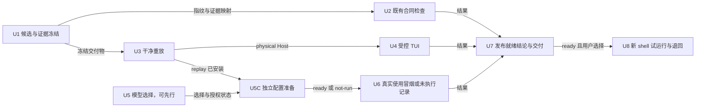
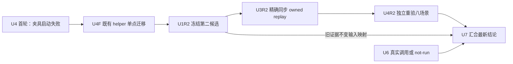
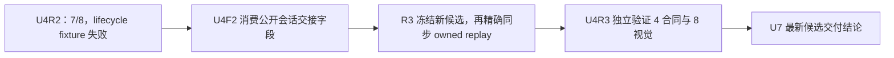

# Pi 1.3.0 隔离升级、候选验收与切换准备实施计划

> **给执行 agent：** 必须逐任务执行本计划；步骤使用 `- [ ]` 复选框跟踪。首轮审阅与主会话修订已完成，用户现已明确选择 **Subagent-Driven**，按本计划 DAG 持续推进 ready set。

**目标：** 从当前已经完成开发和定向验收的 Pi 1.3.0 隔离候选出发，交付可复现的升级包、实际使用证据、独立试运行入口与退回说明；原 `pi-config` 在本计划执行期间保持原版本和原运行环境。

**架构：** 沿用独立 clone 与现有环境入口，不建立第二套任务、通知或 workspace 管理框架。固定已经验证的版本和三个必要生产适配，通过代码指纹关联旧证据，再在第二个独立目录重放候选。新增使用验证、真实模型调用、未来正式启用分别记录结果与授权边界。

**技术栈：** Node `>=22.19.0`、TypeScript、npm 官方 registry、Pi 四核心 `1.3.0`、`pi-subagents@0.79.2`、现有受控 PTY、现有 typed subagent/workspace/supervisor 工具。

**计划状态：** 首轮计划审阅和主会话修订已完成，用户已选择 **Subagent-Driven**。U1/U2/U3 已完成且经主会话核验；U5/U5C 已记录 awaiting-user/not-run，U6 已产出并核验 not-run 记录（实际调用 0）。§12/§13 的两个既有显示夹具迁移已完成；R3 冻结和 replay 同步均经主会话核验，U4R3 的 helper-contract 4/4、视觉 8/8，全部 Host 自然退出/reap，lifecycle new/switch/fork/reload 真实到达。U7 文档与交付包汇合已完成：唯一新档记录与文档补充附件已生成，结论为 **candidate-only**（FP3 `e7b7d7a6…`，真实 provider 未执行、调用 0）；U5C 步骤 2/3、U6 步骤 2–5、U8 仍为 not-run/未授权。联合评估和升级收尾清单继续承担事实与历史证据索引；首轮审阅记录为独立根 `reports/upgrade-release-plan-review-1.md`，未自动复审。

## 1. 全局约束

- 用户要求：**「此次升级，需要在独立目录进行开发与测试，不要影响 pi-config 环境。」**
- 用户已同意旧 1.0.4 低影响收尾大部分归档；本计划不重开 required-child 诊断顺序、F8 自动接管、child 控制作用域、空闲通知、`resume(model)`、`pi -c` guard 或 scheduler 并发建设。
- 开发根固定 `/Users/leshi.zhy/pi-upgrade-1.3.0`，当前 checkout 为其中 `repo/`，分支 `upgrade/pi-1.3.0`。
- `/Users/leshi.zhy/pi-config` 仅允许只读核对：不在其中安装、测试、启动目标 Host，不修改其源码、配置、依赖、用户现场或运行状态。
- 必须使用独立 clone，不使用与原仓共享 Git common-dir 的 worktree；不 stash/reset 或覆盖任何 dirty 现场。
- Pi 四核心精确 `1.3.0`；`pi-subagents` 精确 `0.79.2`；scheduler / pi-shared / croner 保持 `0.1.9 / 0.1.9 / 10.0.1`。codemode 由上游精确依赖解析为 `1.3.0`，不恢复旧 override。
- npm 只能使用 `https://registry.npmjs.org/`，缓存、配置、session、workspace、owner registry、subagent 临时根均在本次独立根内。现有 root broker/coordinator 另使用固定短 IPC 目录，例外和本次 namespace 限定见 §3.1；TMPDIR 不会重定向这些 socket。
- 不读取或复制原仓凭据、`pi/models.json`、`pi/settings.json`、旧 session/proof/ledger、crash/backup；不得输出任何 token、credential 或 authorization 内容。
- 不新增测试、全新 fixture 或压力场景；既有测试/fixture 可随本次已授权迁移调整。若现有入口无法证明某项行为，保留缺口，建议新增测试必须单列待授权。
- 禁止实际启动或调用 MCP，即使某些历史测试提供本地 MCP fixture 也不执行。
- 不自动运行 H2/SIGKILL、五-child 真实模型 probe；不自动调用真实 provider；不把编写计划或选择执行方式解释成授权这些额外动作。
- 不运行真实 `init-pi.sh`：它还会修改 shell 集成、全局 skills 和 uv tool。本计划使用已审计的分步入口。
- 所有展示变化只在 TUI renderer 层；不为展示改写 raw message/tool result/details/session payload。
- 保留 root broker、workspace/coordinator/queue/proof、session-owner、supervisor gate 与 typed model-only 工具面。上游 session succession、child lease、resume 不替代本仓 owner、publication 或终局证明。
- 异常先记录实际入口、首个偏离点、身份和事件/资源链：合法生产数据修最小兼容缺陷；缺件/旧断言只修测试；来源不明 fail closed，不预加 fallback。
- 不默认 stage、commit、push、merge 或修改正式 shell 入口；这些操作只在相应用户授权范围内执行。

## 2. 当前基线与已完成工作

### 2.1 代码与环境

- 当前仓库 HEAD：`35e3e7706af99b43578c6771056a4968d08cc601`，升级代码仍在未提交工作树中。
- 计划编写前的清点：52 个 tracked 修改文件、5 个新文档；本计划本身不包含在该历史清点中。执行时按 U1 重新生成清单，不能把这个计数当文件白名单。
- 现成环境入口：`/Users/leshi.zhy/pi-upgrade-1.3.0/env/isolated-env.sh`；隔离说明：同根 `ISOLATION.md`。
- 原物理 Host 最近一次只读核对仍为 `1.0.4`；新 checkout 实装四核心/codemode `1.3.0`、subagents `0.79.2`。

### 2.2 已完成的三个生产适配，不重新开发

| 已完成项 | 代码位置 | 保留的合同 |
|---|---|---|
| watchdog 返回 Host `Box` 子类的身份探针 | `packages/pi-subagents-enhanced/src/host-runtime/index.ts` | 模块同源校验仍严格，未跳过 watchdog |
| fullscreen overlay `handleMouse` | `packages/pi-subagents-enhanced/src/tui/session-viewport.ts`、`src/background-activity/detail-controller.ts`、`presenter.ts` | MainScreen raw SGR 路径保留；滚动仅改变显示投影 |
| supervisor 两段 wake 的请求注册 | `packages/pi-subagents-enhanced/src/subagent-dispatch/extension.ts` | `before_agent_start` 扫描活跃分支并复用原注册；保留 busy `message_end`、durable 去重和 root/session/request 单飞；不增加 sender 或放松 gate |

### 2.3 已有证据的使用规则

以下报告已经存在于独立根 `reports/`，各轮文件有重叠，不能加总成“全仓绿”：

| 报告 | 已证范围 |
|---|---|
| `final-supervisor-completion-1.3.0.md` | 两工程 typecheck、doctor、package verify；membrane 112/112；gate-wire 8/8；supervisor 14/14；completion 2/2 |
| `recheck-wheel-1.3.0.md` | 6 个 TUI 相关文件 60/60；两个原滚轮断言转绿；typecheck 通过 |
| `recheck-peer-workspace-1.3.0.md` | peer 4/4、queue 28/28、settlement 12/12、terminal-proof 1/1 |
| `recheck-ui-scheduler-1.3.0.md` | scheduler 四文件 51/51，活动/工具边界等其余定向证据；其中两个历史滚轮红灯已由 wheel 轮取代 |
| `recheck-host-lifecycle-1.3.0.md` | heartbeat prepare-only 3/3：公开处置、父自然退出、remaining 空；不证明父死恢复 |
| `recheck-core-1.3.0.md` | fixture/版本/包装/工作流等 11 文件；其中 peer theme stub 的历史红灯已由 peer-workspace 轮取代 |

执行任务不得机械重跑所有已绿用例。U1 先将证据绑定到代码指纹；只有指纹变化、隔离重放或尚未验证的行为需要新一轮检查。

## 3. 文件与产物职责

记号仅用于说明目录，不是新的环境变量或接口：

| 目录 | 固定路径与职责 |
|---|---|
| 开发 checkout | `/Users/leshi.zhy/pi-upgrade-1.3.0/repo`，保存现有代码与本计划 |
| 候选冻结物 | `/Users/leshi.zhy/pi-upgrade-1.3.0/evidence/release`：文件清单、SHA-256、补丁、已列明文档与环境入口副本 |
| 干净重放根 | `/Users/leshi.zhy/pi-upgrade-1.3.0/replay`，内部 `repo/` 是另一独立 clone，`env/` 放环境入口副本；不与开发根共享 node_modules、状态或 `.git` |
| 新一轮日志 | `/Users/leshi.zhy/pi-upgrade-1.3.0/logs/release`，按任务子目录保存 stdout/stderr/exit |
| 决策与使用记录 | `/Users/leshi.zhy/pi-upgrade-1.3.0/reports/release`，非敏感 JSON/中文记录 |
| 仓库交付记录 | `docs/plans/records/2026-10-21-pi-1.3-release/`，最终摘要和证据索引，不纳入凭据、session 或海量 raw 日志 |

新增生产模块：**无**。新增测试或 fixture：**无默认项**。若执行中出现必须修复的兼容缺陷，先完成来源分类，再派单点修复并明确 WritePaths；不得把本表当作任意源码修改授权。

外部目录型 WritePaths 的派发以独立根为 `cwd`；仓库文档型 WritePaths 以对应 checkout 为 `cwd`。混合输出的 U7 统一使用独立根，其仓库文档路径写为 `repo/docs/...`。这些都是文件写入合同的相对 POSIX 路径，不向 typed 工具传绝对 WritePaths。

### 3.1 现有 runtime 的短 IPC 目录例外

这些是 runtime 子进程的资源副作用，不是允许 agent 任意编辑的文件目录，也不能塞进只接受相对路径的 `writePaths` 参数：

- root broker：`/tmp/pi-root-subagent-<uid>/<sha256(rootSessionId)>.sock`；grant：同根 `grants/<sha256(rootSessionId + NUL + runId)>.json`。来源为 `root-broker-protocol.ts` 的 `shortRoot/brokerSocketPath/brokerGrantPath`。
- coordinator：`/tmp/pi-workspace-coordinator-<uid>/<sha256(absoluteGitCommonDir).slice(0,32)>.sock`。元数据仍只写本次独立项目 `.git/.pi-coordinator`；来源为 `coordinator-registry.ts`。
- 适用阶段：U2 的真实 SDK/runtime 检查，以及 U6/U8；U3 的 doctor/安装若实际触发这些入口也适用。仅使用本次新 session/run UUID 和独立 common-dir，不能导入旧 session 或引用原仓 common-dir。
- 入口前只以 `lstat` 核对这两个父目录：若已存在，必须是当前 uid 自有、非 symlink、权限 `0700` 的目录；否则停相关 runtime 阶段，不替用户修权限。源码会对父目录 `chmod 0700`，因此不能让本计划首次改变一个不符合前提的既有公共目录。目录不存在时，允许现有 runtime 按原实现创建。
- 不枚举、读取、删除、接管其它 session/repository 的 socket 或 grant。记录本次从公开回执得出的精确 endpoint；正常 shutdown 只回收本次 namespace，残留则留证，不执行共享目录清扫。
- 这条例外承认既有 IPC 绝对路径，不改变原 `pi-config` 代码、配置、依赖或状态。若用户另要求连这类短 IPC 都不得落在独立根外，则相关阶段标记 `not-run` 并上报，不以设置 TMPDIR 冒充满足，也不默认重构 runtime。

## 4. 授权和交付层次

- **当前可交付层次：** 独立开发完成、定向验收通过，尚未正式启用。
- **计划执行选择：** 首轮 reviewer 返回且主会话修订后，用户选择 Subagent-Driven 或 Inline，才开始 U1–U8。
- **U5 的模型选择：** 当前没有选定本轮真实 provider/model。U5 只记录用户选择、真实调用授权和配置方式，不启动 Host；缺输入时产出明确 `awaiting-user` 状态，不等待到阻塞其它任务。
- **U5C 的配置准备：** 等 U3 的 replay 安装就绪后，再根据 U5 使用独立登录或用户选择的配置流程；占用与 U4/U6 相同的总 Host 槽位。没有准备授权或配置未就绪时产出 `not-run`。
- **U6 的汇合状态：** U5C 未就绪时，U6 只生成 `not-run` 结果及原因，不调用模型；该结果允许 U7 交付 `candidate-only`，但不能触发 U8。用户后续提供选择或授权时，只重开 U5/U5C/U6 的相应部分。
- **受控 PTY/视觉：** U4 提出运行现有 8 场景（无真实模型、无 SIGKILL）；在用户选择执行本计划时应明确包含这项现有检查。若用户不选择该项，U4 记录未验，不能伪填通过。
- **提交/推送：** 作为交付时独立可选动作，不是本计划默认步骤。
- **正式原仓升级/入口切换：** 不在当前独立开发测试授权内。U8 只在新 shell 试运行隔离版；任何原仓安装、合并、持久 shell 改写均须另获明确授权。

## 5. DAG



**依赖边理由：**

- U1→U2：检查消费冻结的源码、lock 和先前已证范围。
- U1→U3：重放消费相同基线、补丁、文档清单和环境入口。
- U3→U4：受控 TUI 必须从干净重放的 physical Host 启动。
- U3→U5C：配置准备所需 replay Host 和 agent 目录已经存在。
- U5→U5C：提供用户选择、准备/调用授权与配置方式；U5 本身不启动 Host。
- U5C→U6：提供同一个 replay 的安装绑定和配置状态；未就绪也产生明确 `not-run` 结果，不伪造成功。
- U2/U4/U6→U7：汇合静态/协议、终端、实际使用三类结果；输入为 `not-run` 时最多交付 candidate-only。
- U7→U8：仅 `ready-for-isolated-trial` 且用户选择后使用该候选；`candidate-only/blocked` 不进入试运行。

U2 不依赖 U3；U5 可以提前结束为 selected 或 awaiting-user。U4/U5C/U6 使用同一个总 Host 槽位，资源排他不伪装成 DAG 边。

## 6. Waves 与资源

- Wave 1：U1、U5（可并行；U5 缺输入仍产出状态记录）。
- Wave 2：U2、U3（等待 U1）。
- Wave 3：U4、U5C（分别等待 U3，以及 U3+U5；占总 Host 槽时排他）。
- Wave 4：U6（等待 U5C 的 ready/not-run 结果）。
- Wave 5：U7（等待 U2/U4/U6 的结果，允许明确未执行状态）。
- Wave 6：U8（满足 ready 及用户试运行选择后）。

Wave 仅展示分层，不要求整波结束后才调度下一任务。所有前驱完成即可入 ready set。

**预计关键路径：** U1→U3→U5C→U6→U7→U8；U3→U4→U7 是另一条验收支路，若终端耗时更长则它决定汇合时间。真实模型输入不到时，U5C/U6 以 not-run 汇合出 candidate-only，不以无期限等待延长关键路径。

**资源上限：** 同一重放根的安装/peer 绑定独占；进程内检查可与独立安装并行；所有真实 Host/PTY/provider 登录与调用共用一个总槽位；不启动不受控 watch/server/daemon。

## 7. 实施任务

### U1：冻结候选、绑定已有证据并制作可重放交付物

**Deps：** none。

**WritePaths：** 以独立根为 cwd：`evidence/release/**`、`reports/release/candidate.json`。

**Resources：** 开发 checkout 源码冻结；无 Host、无网络。

**Files：** Read 当前 `repo/` 的 tracked diff、5 个已列明新文档、本计划、`env/isolated-env.sh`、`ISOLATION.md`；Create `candidate.json`、`candidate.patch`、`files.sha256`、`untracked-documents.json`、`evidence-map.json` 及精确列明的文档/环境副本。

**接口契约：** Produces `candidate.json`，字段为 `schemaVersion:"pi130-candidate.v1"`、`baseCommit`、`branch`、`sourceFiles:[{path,sha256}]`、`lockFiles:[{path,sha256}]`、`packageVersions`、`patchSha256`、`documentFiles:[{path,sha256}]`、`environmentSha256`、`evidenceMap`、`candidateFingerprint`。`sourceFiles` 包含运行实现、安装脚本、测试、配置模板、profile/规范等会影响执行或 prompt 的文件；纯 `docs/**` 与 README 说明归入 `documentFiles`。`candidateFingerprint` 对按路径排序后的 `{baseCommit,sourceFiles,lockFiles,packageVersions,environmentSha256}` 作固定 JSON 编码并计算 SHA-256；纯文档附件另有 hash，不触发运行证据失效。不得包含配置正文、凭据、owner token 或真实会话数据。

**验收标准：** 每项可交付源码/文档都有精确路径和 hash；只有代码指纹相同且先前日志明确覆盖的项目标为已证；改动清单不会因本机未跟踪文件被无意扩大。

- [x] **步骤 1：核对基线和所有 dirty 来源。** 运行 `git status --porcelain=v1 --untracked-files=all`、`git rev-parse HEAD`、`git diff --check`；expected base 为 `35e3e77`。出现他人新改动只记录并停止打包该项，不覆盖。
- [x] **步骤 2：冻结源码和文档白名单。** 用 tracked diff + 本计划和已声明的 5 个新文档生成路径清单；拒绝绝对路径、越界路径以及 `pi/auth.json`、`pi/models*.json`、`pi/settings.json`、crash/backup、`.env`、运行时目录。**`.pi/handoff/context-handoff.md` 是持续更新的会话恢复记录，明确排除在产品补丁、documentFiles 和 candidateFingerprint 外**；用户这次要求的追加不能被误当新增兼容代码。大量文件由一次辅助脚本批量计算 hash，禁止逐文件调用工具。
- [x] **步骤 3：导出未提交候选。** 一次辅助脚本将步骤 2 的显式 tracked 路径数组传给 `git diff --binary HEAD --`，按原始字节保存为 `evidence/release/candidate.patch`，不导出整树未筛选 diff；精确复制白名单新文档和外部环境入口。不能运行 `git add` 或 commit；补丁不包括 handoff、ignored 依赖、机器配置或状态。
- [x] **步骤 4：生成证据映射。** 引用 §2.3 现有报告及其真实检查范围；新加的测试 helper、生产 handler、锁文件若没有相同快照证据则标待验证，不据“整组之前绿”推断。
- [x] **步骤 5：记录候选冻结完成。** 后续源码发生变化即失效相应 fingerprint；更新 U1 并只重做受影响验证，不能沿用旧 hash 的通过结论。

### U2：补跑尚未覆盖的既有 SDK、模型与 RPC 合同

**Deps：** U1（消费 `candidate.json` 指纹与 evidence map）。

**WritePaths：** 以独立根为 cwd：`logs/release/contracts/**`、`reports/release/contracts.json`、`cache/tmp/**`、`cache/subagents/**`。

**Resources：** 无真实 provider；local HTTP fixture 只绑定回环；真实 SDK 检查会创建临时 session/agent/Git 目录，全部随隔离 TMPDIR。触发 broker/coordinator 时另遵守 §3.1 的精确 IPC 例外；其余进程内文件可并行于 U3 安装。

**Files：** Read 既有 `test/joint-upgrade-provider.test.mjs`、`test/joint-upgrade-session.test.mjs`、`test/joint-upgrade-model-policy.test.mjs`、`test/joint-upgrade-rpc-wire.test.mjs`、`test/joint-upgrade-ceiling-runtime.test.mjs`；不创建测试文件。

**接口契约：** Produces `contracts.json`：`candidateFingerprint`、`status:"passed" | "failed" | "not-run"`、`reason`、`checks:[{command,exit,tests,pass,fail,skip,log,scope}]`、`limitations`。本地合成 SSE 结果不得标为真实 provider 成功。

**验收标准：** 未覆盖的公开接口按真实目标依赖执行，或准确说明不适用/受限；不通过修改版本断言、延 timeout 或生产 fallback 追绿。

- [x] **步骤 1：先静态审计这 5 个文件及其 helper。** 排除实际 MCP、真实外部网络、SIGKILL、全局 SDK 回落。若报告与代码矛盾，停该文件并记录，不整体改跑 `npm test`。
- [x] **步骤 2：在开发根隔离 shell 下逐文件执行。** 先 source `env/isolated-env.sh`，再分别运行上述 5 条 `node --test`；只补 evidence map 中尚未证的项。已证指纹相同的单元/doctor/package 不重复跑。
- [x] **步骤 3：完整记录单次执行。** source 会启用 `set -e`，包装器必须显式捕获非零 exit，再写 `.exit`；不用 `tail`/管道最终状态代替真 exit，不因日志文件没写 exit 自动重复测试。
- [x] **步骤 4：按来源分类处理红灯。** 写实际调用链与最小修复建议，停止依赖该项的就绪声明；不在本验证任务内写生产或测试源码。

### U3：在第二独立目录重放候选并验证依赖闭包

**Deps：** U1（消费基线、补丁、文档清单及环境入口副本）。

**WritePaths：** 以独立根为 cwd：`replay/**`、`logs/release/replay/**`、`reports/release/replay.json`。

**Resources：** `replay` 安装根独占；official npm 网络；安装与 peer 绑定期间不启动该根 Host。

**Files：** Create `replay/repo/` 独立 clone、`replay/env/isolated-env.sh`；Apply 已冻结补丁及文档；Generate 被忽略的非敏感 `replay/repo/pi/settings.json`；安装三处依赖树。

**接口契约：** Produces `replay.json`：`candidateFingerprint`、`status:"passed" | "failed" | "not-run"`、`reason`、`checkoutRoot`、`gitCommonDir`、`physicalHostRoot`、`nodeBin`、`installedVersions`、`peerRealpaths`、`settingsSource:"tracked-template"`、`checkResults`。环境脚本以自身位置求根，复制到 `replay/env/` 后配置、依赖和持久状态落在 `replay/`；短 IPC 例外按 §3.1 记录。

**验收标准：** 没有从开发根或原仓 symlink 借入依赖；补丁源码 hash 与 U1 一致；目标版本、peer identity、锁文件与 scheduler 版本一致；检查成功不依赖旧缓存布局。

- [x] **步骤 1：创建独立 clone。** `replay/repo` 不存在时执行 `git clone --no-local /Users/leshi.zhy/pi-upgrade-1.3.0/repo /Users/leshi.zhy/pi-upgrade-1.3.0/replay/repo`，核对 base 为 `35e3e77`。若目录已存在，先核对身份/现场，不覆盖、不 reset、不自动删重建。
- [x] **步骤 2：应用冻结交付物。** 对补丁先 `git apply --check` 再 apply；按 U1 精确复制新文档，复制环境入口和隔离说明。核对所有 source/lock hash 与 U1；此步无 commit。
- [x] **步骤 3：分步安装并刷新父 shell 绑定。** 在新的 bash 子 shell source `replay/env/isolated-env.sh`，确认求得的 `PI_UPGRADE_ROOT` 为 `.../replay`。依次执行 `npm ci --ignore-scripts --no-audit --no-fund`、`node scripts/setup-subagent-runtime-deps.ts`。**安装完成后必须再次 source 同一 replay 环境脚本**，再执行 `node scripts/ensure-pi-settings.ts`、`node scripts/sync-skills.ts`。首次 source 时 CLI 不存在，`PI_REAL_BIN/PI_HOST_ROOT` 会保持 unset；setup 子进程的补值不会回填父 shell。不运行 init、不复制机器配置、不借用开发根依赖。
- [x] **步骤 4：闭包与 fresh physical 检查。** 刷新后核对 `PI_REAL_BIN` 非空且 realpath 位于 replay，读取 metadata/lock/peer realpath；执行 `node "$PI_REAL_BIN" --version`、`npm run typecheck`、`npm run doctor`。`setup-subagent-runtime-deps.ts` 已执行 package verify，保留该子命令的真实输出/exit；若 package 输入自该次检查后未变，复用它，不再重复 `verify:package`。检查官方 resolved/integrity、无 chord 和旧 override、scheduler 三包未漂移。
- [x] **步骤 5：登记可复现结果。** `git diff --check`，确认安装未改变候选源码/lock，记录真实 exits 与 peer realpaths；适用时记录 §3.1 本次 IPC namespace。失败按来源处理，禁止借入开发根 node_modules 来补绿。

### U4：运行现有受控终端场景，确认 TUI 和生命周期后验

**Deps：** U3（消费 replay physical Host 与独立 env）。

**WritePaths：** 以独立根为 cwd：`replay/cache/tmp/**`、`logs/release/tui/**`、`reports/release/tui.json`。

**Resources：** 总 Host/PTY 槽位 1；`python3` PTY；不使用真实模型或凭据。

**Files：** Read 已有 `test/background-activity-visual.integration.mjs`、`test/helpers/background-activity-visual.mjs`、`controlled-pty.mjs`、`controlled-pty-driver.py`、`test/fixtures/background-activity-visual.ts`、`test/controlled-pty-contract.test.mjs`。

**接口契约：** Produces `tui.json`：`candidateFingerprint`、`status:"passed" | "failed" | "not-run"`、`reason`、`scenarios`、`exits`、`framePaths`、`closeResults`、`manualObservations`、`unverified`。U3 失败或用户未选择 U4 时，写 not-run 与上游原因，不启动 PTY；不能伪填通过。渲染帧来自本次自造 fixture，不读取真实 session/debug log。

**验收标准：** 8 个现有场景分别有真实执行和自然退出事实；无强杀、无转用 MainScreen 避开 fullscreen；自动帧断言与人工观感分别记录。

- [x] **步骤 1：核对受控 PTY 合同。** 确认 driver 不接管外部 PID、默认禁 `signalFixtureKill`，现有 fixture close 走 Ctrl+D/reap。先运行 `node --test test/controlled-pty-contract.test.mjs`（审计若包含真实未授权信号则停止该项，不能靠全局开启许可）。 本轮真实 exit 0，7/7 通过；该证据在 helper 修订后仅按不变输入复用。
- [x] **步骤 2：在 replay 环境运行已有视觉文件。** `PI_TEST_BG_VISUAL=1 node --test test/background-activity-visual.integration.mjs`；8 个场景为 base/long/widths/heights/draft/themes/lifecycle/rpc。不得设置 `PI_TEST_OWNER_SIGKILL` 或 H2 开关。
- [x] **步骤 3：分别核对字段。** footer 空行与模型标签、Alt+O/detail、draft 恢复、窄屏/矮屏、light/dark、new/switch/fork/reload 和 RPC stdout 零 ANSI。具体通过只按现有文件真实断言认定；visual lifecycle 通过不等于 14 个工具的历史恢复已验证。
- [x] **步骤 4：失败保留现场。** driver 超时保留 exact root/PID/birth 和 exit 事实，不补杀，不删状态目录，不延原 timeout。确认没有遗留自造 Host 后释放总槽位。
- [x] **步骤 5：记录剩余边界。** detail fullscreen 的专门行为、多行加速滚轮、真实终端惯性若现有场景未覆盖，仍列未验；不为填格子新增用例。 最新综合验收见 U4R3：4 合同与 8 视觉分别全通过。原 R1 close/reap 缺口与 R2 lifecycle 失败仍保留；footer 空行等无现有断言的字段仍未验。

### U5：先行记录真实 provider/model 选择与授权状态

**Deps：** none。

**WritePaths：** 以独立根为 cwd：`reports/release/provider-selection.json`、`reports/release/provider-setup.md`。

**Resources：** 用户选择和非敏感状态记录；不登录、不启动 Host、不调用模型、不读取密钥。

**Files：** Create 上述两份记录；Read 现有 profile/model 准入规范；本任务不写任何 auth/models 文件。

**接口契约：** Produces `provider-selection.json`：`schemaVersion:"pi130-provider-selection.v1"`、`selectionStatus:"selected" | "awaiting-user"`、`provider`、`modelId`、`qualifiedModel`、`agentProfile`、`realCallsAuthorized`、`setupAuthorized`、`configurationMethod`。未选择的字符串字段用 `null`，不写可执行占位模型；授权布尔字段只有用户明确同意才为 true。

**验收标准：** 有选择则精确记录 qualified model 和准备/调用授权；没有输入也可完成本任务，结果为 awaiting-user。该状态不允许 U6 调用模型，但不阻塞 U2/U3/U4。

- [x] **步骤 1：一次性说明需要的输入。** 精确 provider/model、是否允许本轮有限真实调用、独立登录或用户配置方式。不要求用户在聊天粘贴 key，不从可用目录自主替用户选模。
- [x] **步骤 2：记录实际收到的决定。** 凭据仅由后续 U5C 的支持入口准备；本任务不等待 replay Host，不复制原仓配置。
- [x] **步骤 3：写选择或未就绪状态。** 用户暂不提供输入时输出 `awaiting-user` 和原因；以后有新输入再更新 U5 结果，不把沉默视为授权。

### U5C：在已安装 replay 中准备独立配置

**Deps：** U3（replay Host/agent 目录）、U5（用户选择、准备/调用授权与配置方式）。

**WritePaths：** 以独立根为 cwd：`replay/repo/pi/**` 中仅用户明确选择的机器级配置产物、`replay/cache/**`、`replay/state/**`、`reports/release/provider-readiness.json`、`reports/release/provider-setup.md`。不改 tracked profiles、扩展或候选源码；不将 auth/models/settings 纳入 U1 代码包。

**Resources：** 登录/配置若启动 Host，占用与 U4/U6 相同的总 Host 槽位；没有准备授权时不占槽。

**Files：** 用户或支持的 `/login`/provider 配置流程创建 replay 独立 auth/model 配置；Create `provider-readiness.json`。agent 不读取或复制原仓凭据。

**接口契约：** Produces `provider-readiness.json`：`candidateFingerprint`、`status:"ready" | "not-run" | "blocked"`、`reason`、`configRoot`、`physicalHostRoot`、`qualifiedModel`、`agentProfile`、`realCallsAuthorized`、`configReady`。不得包含密钥、认证头或凭据正文。

**验收标准：** 只在 U5 有精确选择、明确准备授权且支持配置就绪时标 ready；模型必须满足本次 profile 准入，不能改 profile、放宽 ceiling 或自动换模。U5 未就绪时写 not-run，结果本身可被 U6/U7 汇合。

- [x] **步骤 1：核对 U3 与 U5 结果。** U3 安装失败则 blocked；U5 awaiting-user 或 setupAuthorized=false 则不启动 Host，写 not-run 原因。
- [ ] **步骤 2：按用户选择准备认证。** 优先启动 replay 登录专用 CLI：显式 `--no-session --no-extensions --no-skills --no-prompt-templates --no-context-files --no-mcp`，在其中使用原生 `/login`，不加载业务 runtime 或发起 prompt。自定义 provider 需要扩展时，只显式加载用户选定的 provider 入口；它需要额外状态写入而未被声明时先停并报告。自定义非敏感定义明确写入 replay，不整文件复制原机器配置。登录窗口正常关闭、相关 Host 退出后才交出总槽。
- [ ] **步骤 3：只核对名称与准入。** 可列可用 provider/model 名称，不打印 key；确认 parent 与所选 child profile 都能接受精确 qualified model，拒绝时 blocked，不自主换模。
- [x] **步骤 4：产出 ready/not-run/blocked。** 没有真实调用授权时即使配置成功，也保留 `realCallsAuthorized:false`，U6 只能写 not-run。 本轮结果 not-run；步骤 2/3 未执行，不代表登录或准入失败，缺少的是用户已有三项输入。

### U6：以真实选择执行最小端到端使用冒烟

**Deps：** U5C（同一 replay 的 physical Host 绑定、精确模型与配置/授权状态）。

**WritePaths：** 以独立根为 cwd：`replay/trial-project/**`、`replay/sessions/**`、`replay/state/**`、`replay/cache/**`、`logs/release/real-smoke/**`、`reports/release/real-smoke.json`。

**Resources：** 总 Host 槽位 1；真实 provider 的有限调用；仅本次独立 Git 工作项目，不操作候选仓或原仓。使用 broker/coordinator 时遵守 §3.1 的短 IPC 例外。

**Files：** 使用现有 `scripts/pi-launcher.zsh` 与 typed tools；创建普通验收 Git 项目和 README，不创建新的自动化 test、fixture provider、工具或 sandbox 框架。初始化提交与 child 正常集成仅发生在该验收项目，属于用户选择的冒烟范围；不等于允许提交升级候选或原仓。

**接口契约：** Consumes `provider-selection.json`、`provider-readiness.json`；Produces `real-smoke.json`：`candidateFingerprint`、`status:"passed" | "failed" | "not-run"`、`reason`、`qualifiedModel`、`actualParentModel`、`actualChildModels`、`sessionRoot`、`runIds`、`workspaceIds`、`checks`、`costOrUsageIfAvailable`、`retainedArtifacts`、`limitations`。只记录 public receipts，token 不入报告。

**验收标准：** 真实调用有明确授权且配置 ready 时，实际 parent 和两个 child 都使用 U5 选定的模型，完成一次普通回合、一次 generic 派发和一次 coding child 的正常集成/释放。未授权或未就绪时产出 not-run，不执行任何真实调用；该状态不是通过，但允许 U7 交付 candidate-only。

- [x] **步骤 1：先完成可汇合状态判断。** U5C 为 not-run/blocked，或 `realCallsAuthorized!==true` 时，直接写 `real-smoke.json.status="not-run"`、对应原因与 fingerprint，结束任务；不等待、不去旧环境借凭据。U5C ready 且真实调用授权为真才继续。 本轮走 not-run 分支，后续步骤 2–5 未执行。
- [ ] **步骤 2：建立最小 Git 前提。** 仅在新建的 `replay/trial-project` 执行 `git init -b main`，配置该仓局部 `user.name="Pi Upgrade Acceptance"`、`user.email="pi-upgrade@example.invalid"`；创建初始 README，仅 `git add -- README.md` 并以 `test(upgrade): 初始化隔离验收项目` 提交。执行 `git symbolic-ref --short HEAD`、`git rev-parse --verify HEAD^{commit}`、`git status --porcelain`，必须 attached main、有基线提交且 clean。已有目录先核对现场，不覆盖或自动提交他人文件，不手工创建受管 worktree。
- [ ] **步骤 3：精确启动 parent 与 generic child。** source replay 环境后显式 `cd /Users/leshi.zhy/pi-upgrade-1.3.0/replay/trial-project`。launcher 必须传 U5 的 `--provider`、`--model`（精确字段）和独立 `--session-dir`，禁 MCP；parent 普通回合读取本项目 README。generic 的 `subagent_start` 参数**显式传 `model=qualifiedModel`**，调用前核对准入，回执后核对实际 parent/child provider/model，一旦不符停止后续调用，不等事后记录才发现。记录 typed 回执、completion 和父续跑。
- [ ] **步骤 4：精确启动 coding child。** 同一已确认 profile、`model=qualifiedModel`，只允许本次 README 一个明确变更，使用现有 worktree/queue 正常自发布。初始化/集成所需 Git 提交仅作用于验收项目；public workspace 动作按实际允许状态执行，released 不重复处置，不 raw integrate、不延 child 生存等待、不主动触发 F8。若同时获得长结果场景的具体授权，可在 generic 场景验证超过 2000 字符的有界结果与 artifact 全文；否则保留限制，不新增自动化用例。
- [ ] **步骤 5：正常关闭并记录 passed/failed。** stdin EOF 或 UI 正常退出；记录自己创建的 Host/child 是否终止，以及 queue/publication/receipt。实际失败写 failed 并留证；不自动换模、重复调用或扩大范围。

### U7：汇合发布就绪结论与可审核交付包

**Deps：** U2、U4、U6（消费各自独立结果，不重复添加已经传递满足的依赖）。 若进入 §12 的候选修订路径，则 U4R2 替代原 U4 作为最新终端结果，并同时消费 U3R2 的当前源码匹配结果和 U1R2 的旧证据复用映射；原 U4 失败不能直接触发就绪交付。若进入 §13，则 R3 的冻结/同步两阶段和 U4R3 替代上一修订作为最新候选匹配与终端依赖，历史 U4R2 7/8 不作为当前通过结论。

**WritePaths：** 以独立根为 cwd：`repo/docs/plans/records/2026-10-21-pi-1.3-release/readiness.md`、`repo/docs/todos/2026-10-21-pi-1.3-upgrade-closeout.md`、`repo/docs/plans/2026-10-21-pi-1.3-upgrade-release.md`（仅 U7 复选框/交付状态）、`reports/release/readiness.json`、`evidence/release/**`（只新增 documentation supplement/校验记录，不覆盖 R1/R2/R3 冻结物）。同一 cwd 下均为相对路径，不写到 `repo/reports` 或 `repo/evidence`。

**Resources：** 无 Host；文档汇总与候选源只读，不允许用“最后再跑一遍”无理由扩大回归。

**Files：** Create `readiness.md/json`；更新升级收尾入口与本计划 U7 实际完成状态。保留三代原冻结补丁及 hash；新增 `evidence/release/documentation-supplement.patch`、精确文档副本和 `documentation.sha256`，仅相对 R3 文档快照生成 delta。最终使用顺序为最新 R3 full patch + 同六文档/env + 文档 supplement，不能叠加 R1/R2/R3 full patch。纯文档附件须在一次无依赖独立临时 clone 从 base 重放核验；不修改 replay 已验证快照，不运行 Host/测试/安装，不默认 stage/commit。收尾 checkbox 只能据实际结果勾选，并使最终附件与报告 hash 反映完成后的计划文档。

**接口契约：** `readiness.json`：`candidateFingerprint`、`replayMatch`、`contractChecks`、`tuiChecks`、`realProviderChecks`、`remainingLimitations`、`decision:"ready-for-isolated-trial" | "candidate-only" | "blocked"`、`originalEnvironmentChanged:false`。

**验收标准：** 没有数据支撑的项明确未验；结果与代码/lock fingerprint 一致；冻结的 1.0.4 事项不重新成为前置；用户拿到可以审核的差异与回退步骤。

- [x] **步骤 1：校验 fingerprint 和输入结果。** 有源码变更未重新绑定时不发布 ready 结论；修复后的文档差异单独列，不冒充已跑全量回归。 本轮重算 FP3 得 `e7b7d7a6…`：49 source + 2 lock + `environmentSha256` 与 9 versions 逐项不变；相对 R3 文档快照的差异只有本计划与收尾入口两份纯文档（U7 收尾），不动任何运行输入。
- [x] **步骤 2：汇合 passed/failed/not-run。** 先核对 U3 的原始 replay 结果；安装/重放真实失败不能被下游 not-run 掩盖，必须给 blocked。U6 的 not-run 是已产出结果，不是仍在等待的任务；U4 若用户未选择受控视觉，也生成 not-run 记录。没有真实阻塞但有未运行项时交付 `candidate-only`；只有 replay 成功、U2/U4/U6 均通过且指纹一致才标 `ready-for-isolated-trial`。not-run 不能伪填通过，也不会让 U7 永远不可达。 汇合结果：R3 冻结/同步与 U4R3 真跑通过（FP3），U2 13/13 按 FP1 `proved-unchanged` 复用，U6 not-run ⇒ `candidate-only`；历史 R1/R2 失败原样保留。
- [x] **步骤 3：交付补丁、文件清单、hash 与证据索引。** 后续若用户明确授权提交，才按 `git-commit-convention` skill 对这份精确清单提交；push/PR/merge 同样按单独授权范围，不运行 `git add -A` 包入状态文件。 本轮无提交授权：交付以 R3 full patch + 六 docs/env + 文档补充附件与清单 hash 表达，未 stage/commit/push。
- [x] **步骤 4：同步收尾入口并完成文档附件。** 当前完成层次、未验范围、旧账本冻结、原仓未升级事实一致。不抄录凭据、不把中途失败报告删掉或改写为通过；纯文档变更单独打包为补充附件，不改 U1 的 candidateFingerprint 或原 patchHash，不冒充源码已重新验证。 收尾入口与 `docs/plans/records/2026-10-21-pi-1.3-release/readiness.md`、`reports/release/readiness.json` 已同步为 candidate-only；补充包在 `evidence/release/documentation/`，FP3 与三代 patch hash 均未变。

### U8：在新 shell 并行试运行与一键退回原使用方式

**Deps：** U7（仅 `ready-for-isolated-trial` 且用户选择试运行时执行）。

**WritePaths：** 以独立根为 cwd：`replay/trial-project/**`、`replay/sessions/**`、`replay/state/**`、`replay/cache/**`、`logs/release/trial/**`、`reports/release/trial.md`。候选源码 `replay/repo/**` 不在可修改范围。

**Resources：** 用户新终端、总 Host 槽位 1；使用 broker/coordinator 时遵守 §3.1。不能与仍使用同一 root/session 的验收 Host 并发。

**Files：** 使用已冻结的 `replay/env/isolated-env.sh`、`replay/repo/scripts/pi-launcher.zsh`；不写 `~/.zshrc`、原仓配置或正式工具链接。

**接口契约：** Produces `trial.md`：实际启动路径、版本、独立配置/session/state 路径、用户常用操作结果、正常退出事实和是否退回；不记录密钥或私有任务正文。

**验收标准：** 用户可以明确区分新旧环境；退出新 shell 后原终端入口与 1.0.4 环境继续可用；回退不依赖降级 npm、删除新状态或重写旧 session。

- [ ] **步骤 1：新开独立 shell，并显式进入获准项目。** 先确认 U7 为 ready、U5 的精确模型与授权仍有效。以下命令只在该新终端执行；JSON 只读非敏感选择字段，启动参数不读取或打印凭据：

```bash
bash --noprofile --norc
source /Users/leshi.zhy/pi-upgrade-1.3.0/replay/env/isolated-env.sh
selection_file=/Users/leshi.zhy/pi-upgrade-1.3.0/reports/release/provider-selection.json
selected_provider="$(node -e 'const s=require(process.argv[1]); if(s.realCallsAuthorized!==true||typeof s.provider!=="string"||!s.provider)process.exit(1); process.stdout.write(s.provider)' "$selection_file")"
selected_model="$(node -e 'const s=require(process.argv[1]); if(s.realCallsAuthorized!==true||typeof s.modelId!=="string"||!s.modelId)process.exit(1); process.stdout.write(s.modelId)' "$selection_file")"
cd /Users/leshi.zhy/pi-upgrade-1.3.0/replay/trial-project
zsh -f "$PI_UPGRADE_REPO/scripts/pi-launcher.zsh" --no-mcp --tui-mode fullscreen --provider "$selected_provider" --model "$selected_model" --session-dir "$PI_CODING_AGENT_SESSION_DIR"
```

- [ ] **步骤 2：只在 trial-project 做小任务。** 确认 `$PWD` 不是冻结候选 `replay/repo`；不恢复原仓 session，不共享跨环境 workspace/queue/owner registry。parent 使用上面的显式模型；试运行涉及的 generic/coding `subagent_start` 同样显式传 U5 的 `qualifiedModel`，核对准入与 actualModel，不允许 profile 默认候选代选。记录 completion、Alt+O/draft/滚轮是否满足需求，不修改冻结候选。
- [ ] **步骤 3：退回路径。** 正常结束新 Host并退出这一个 shell；回到原先未被修改的终端继续使用原 1.0.4 入口。不跑 npm downgrade、不 reset 原仓、不复制新 session/state 回旧目录，不因试运行失败清理受管 workspace。
- [ ] **步骤 4：完成试运行记录。** 若新环境出现问题，原环境继续可用，同时保留本次独立证据，交主会话分类；未获允许不扩大到“顺手改掉旧缺陷”。

## 8. 正式启用的后续边界与回退设计

本计划的默认终点是**可复现候选 + 已说明边界的独立试运行**。用户原话要求不能影响 `pi-config`，因此此处只给后续启用顺序，**不把原仓修改作为 U1–U8 自动动作**：

1. 用户确认实际使用结果并明确选择正式启用方式：继续以独立目录作为日常入口，或另行授权合入/升级原仓。
2. 若继续独立目录，只改变用户明确选定的新 shell 使用方式；原 1.0.4 安装和状态保留，退回就是退出新 shell。
3. 若选择升级原仓，先只读检查原 HEAD/dirty/其它会话和使用中的 Host，生成精确文件清单、变更摘要与备份方案供批准。不得自动 stash、reset、覆盖他人改动或结束未知 Host。
4. 获得原仓操作授权后再制定对应发布步骤：先保留可运行的旧安装与配置入口，等待旧 runtime 正常退出，再分步安装并启动 fresh Host；不能靠 `/reload` 替换 ESM。没有该授权就停在独立候选，不留下半更新的正式环境。
5. 正式启用中的回退优先切回保留的旧独立安装/入口，不把 1.3.0 新状态或 session 写回 1.0.4。具体原仓备份路径、安装窗口、授权对象由那次真实现场核定，本计划不虚构其已完成。

## 9. 不纳入本计划的工作

- 旧 1.0.4 低影响收尾与历史证据补账。
- F8 typed resume→activation→workspace/queue 自动接管；五-child 原过期验收。
- scheduler 0.1.29 结构结果合同、并发 store/lock 修复。
- 新 notification sender、长期轮询、通用恢复框架或因为同名上游能力而删除已有权威模块。
- 补齐所有覆盖缺口、压力/跨平台测试、SIGKILL、MCP 或真实模型多 provider 矩阵。
- 未授权的代码成果 reviewer、commit、push、merge、发布、原环境改写与旧现场清理。

## 10. 停止条件、预计工作量与验收终点

**停止相关动作并上报：** 源码指纹变化、路径回落原仓、凭据/未知 owner、公开接口不能满足断言、需越 WritePaths、验证与产品事实矛盾、或需要新增测试/危险实验/正式环境写入。已有用户授权足够的常规决定由主会话直接处理，不逐任务问用户。

**预计剩余投入（非已测工期）：** U1–U3 约 0.5–1 人日；U4/U6 约 0.5–1 人日且取决于实际 provider 和终端输入；U7/U8 约 0.25–0.5 人日。原始升级评估的完整 2–4 人日已有相当部分完成，不应再按完整重建估时。出现新的生产兼容缺陷再按证据调整，不用延 timeout 隐藏成本。

**验收终点：** 候选源可审核/可重放、实际选择的模型与常用 TUI 流程有相应证据、原 1.0.4 环境未被修改、试运行可退出退回、冻结事项不再重复建设。未验范围明确记录，不能用多轮重复计数冒充全仓兼容。

## 11. 计划自检与交接

- [x] 计划从已有隔离 1.3.0 基线继续，三处生产适配不重复实施。
- [x] 每个任务写明 Deps / WritePaths / Resources / Files / 输入输出 / 验收 / 步骤；增加 U5C 将先行选择与依赖 replay 的登录准备拆开，DAG 与 Waves 同步。
- [x] 用户未提供模型时，U5/U5C/U6 产生明确 awaiting-user/not-run 记录，U7 仍可交付 candidate-only；Host 登录与测试共享同一资源槽。
- [x] 不新增生产模块、自动化测试或 fixture；临时真实冒烟项目的 Git 初始提交与 child 集成精确限定，不提交候选或原仓。
- [x] 首轮计划 reviewer 已完成：`reports/upgrade-release-plan-review-1.md`。
- [x] 主会话已依据源码修正 4 项 high、2 项 medium：安装后二次 source、运行时路径/短 IPC 例外、trial Git 前提、试运行 cwd/显式模型、U7 cwd、配置依赖与 not-run 汇合；未自动复审。
- [x] 用户已选择 **Subagent-Driven**；按 DAG 开始 U1/U5，之后前驱完成即调度，不再询问执行方式。真实 provider、提交/推送与正式原仓切换的独立授权边界保留。

## 12. U4 既有夹具迁移与候选修订（执行中补充）

### 12.1 已发生的事实与分类

U4 首轮记录 `reports/release/tui.json` 保持原样：受控 PTY 合同 7/7 通过；base 单次 exit 1，首个偏离是 `session_start` 之前的 “Trust project folder?”；其余 7 场景 not-run。调用链为 launcher → physical Host 1.3.0 → `hasTrustRequiringProjectResources` → `resolveProjectTrusted` → 等待输入。夹具将 HOME 设为临时 home，而 cwd 的真实 home 祖先含 `.agents/skills`，因此该目录不再被归为用户级资源。这是**类别 2 的夹具环境条件**，未证明为渲染或生产缺陷。

官方 `docs/security.md`、`docs/cli.md` 和 `resolveProjectTrusted` 确认公开 `--no-approve` 对本进程一次性拒绝项目资源信任、优先返回 override、不写 trust store。现有夹具已关闭全部自动资源发现，所需扩展均显式 `-e`。只迁移已有 helper 的该参数，不恢复真实 HOME、不外移 TMPDIR、不写信任库、不加生产兼容。

旧 base 的 close/reap 未证明，保持 `exited:false/reaped:false/exit:null`；事后精确 PID/root 无活进程只能用于确认当前无存活占槽，不能改写为自然退出。新一轮用全新 fixture root/lease/session，不接管或补杀旧进程。

### 12.2 修订依赖与证据规则



- 修订链替代原 U4→U7 的直接汇合；U6 状态写入可并行，无 Host 时不占槽。
- **不覆盖第一候选**：保留原 `candidate.json`、`evidence/release/candidate.patch`、所有原 hash/日志/失败结果。第二候选位于 `reports/release/candidate-r2.json` 与 `evidence/release/r2/**`。
- 只有现有视觉 helper 和纯文档允许相对第一候选变化；生产源码、两个 lock、版本、安装脚本、环境入口均须逐 hash 不变。发现额外变化立即重新分类和定范围。
- U2/原 U3/受控 PTY 合同的实际运行仍属于第一指纹；必须以原记录 + 具体不变输入映射标 `proved-unchanged`，不能改写旧报告的 fingerprint 或声称又跑过。无法证明依赖闭包不受影响时标未证，不能批量套用旧绿。
- 原 U3 的干净安装证明可以在依赖输入不变时复用；U3R2 只证明新候选与既有自有 replay 匹配，明确不是第二次干净安装。没有新依赖变化时不重复 npm ci/typecheck/doctor/package。
- U5C/U6 的 not-run 是选择与授权状态事实，可经重新读取 selection 并明确 `authorization-only` 关联到第二候选；不把未运行变成通过，也不改写历史真实运行归属。
- 本补充执行既有“来源分类后单点修复、指纹变化只重做受影响验证”规则，不增加测试、真实调用、危险实验、成果 review、commit/push 或正式切换授权。

### U4F：仅修既有视觉 helper 的启动参数

**Deps：** U4 首轮失败及已完成的来源分类。

**WritePaths：** 独立根 cwd：`repo/test/helpers/background-activity-visual.mjs`、`logs/release/tui-fixture-correction/**`、`reports/release/tui-fixture-correction.json`。

**Resources：** 静态实现；无 Host、无安装；与独立真实验证分开派发。

**Files / 接口：** 修改唯一已有 helper 的 `visualArgs`，TUI/RPC 共用 `--no-approve`；报告旧/新 hash、diff、类别 2 调用链、官方接口依据与 `runtimeVerification:not-run`。

**验收：** 保留 offline/no-mcp/全部资源发现关闭和显式扩展链；HOME、断言、timeout、driver、close 和原证据均不变；无新 test/fixture。

- [x] 记录完整 provenance 后仅修改 helper 参数，可运行 syntax 与 diff 静态检查。
- [x] 交付精确 diff/hash；不得在实现任务中运行 PTY 或测试。 实现已完成并由主会话读验 diff，helper 新 hash 为 `05ad2e40d4dbcc8b6b0873da98d79f10faf94fc4613cafe14818c60664e4aad6`；尚未运行修复后的视觉场景。

### U1R2：冻结第二候选并限定证据复用

**Deps：** U4F 完成。

**WritePaths：** 独立根 cwd：`evidence/release/r2/**`、`reports/release/candidate-r2.json`。

**Resources：** 开发源码冻结；无 Host、无网络、无测试。

**Files / 接口：** 沿用 `pi130-candidate.v1` 编码与 fingerprint 算法，增加 `revision:2`、`previousCandidateFingerprint`；源码清单为第一候选显式白名单加唯一新增修改的现有 helper，六个新文档名单不扩大。生成第二候选完整 `candidate.patch`、`files.sha256`、文档/env 副本与包 hash、`delta-from-v1.patch`、`evidence-map.json`、README。delta 只含 helper；纯文档变化由精确副本表达。

**验收：** 原冻结物 byte-for-byte 保留；第二 full patch 供 base 新 clone 应用，不能叠加在第一 full patch 上；owned replay 只用已核对的 delta 与已声明文档。每个复用项记录原 fingerprint/报告、当前不变输入/闭包依据和适用边界。

- [x] 核对第一候选/source diff，拒绝 helper 以外新的运行输入，handoff 继续排除。
- [x] 输出新 full patch、精确 delta/hash、同六文档/env 副本与第二 fingerprint；核验能从 base 重放。
- [x] 映射 U2/原 U3/PTY 合同的不变证据；不覆盖原记录、不自动跑检查追绿。

### U3R2：将第二候选精确同步到已知 owned replay

**Deps：** U1R2。

**WritePaths：** 独立根 cwd：`replay/repo/test/helpers/background-activity-visual.mjs`、`replay/repo/docs/plans/2026-10-21-pi-1.3-upgrade-release.md`、`logs/release/replay-r2/**`、`reports/release/replay-r2.json`。其它文档仅在报告证明有变化且主会话明确扩展路径后复制；禁止以目录级覆盖来绕过。

**Resources：** replay 更新独占；无 Host、无 npm 网络、无安装。

**Files / 接口：** 先确认既有 clone/common-dir、原 58 文件和旧 helper hash 无未知漂移、无本轮旧 Host 存活；只 apply 已核对的 helper delta、复制声明的新计划文档。产出 `replay-r2.json`：新/旧 fingerprint、`mode:owned-replay-update`、source/lock/env 匹配、metadata/peerrealpaths、不变依赖输入和复用原 clean-install 的来源。

**验收：** 第二候选每文件实际 hash、第二 fingerprint 相符；没有回落开发/原仓 node_modules；未把 update 冒充全新安装；不重跑已经不变的绿检查。

- [x] 以旧 manifest 核对 known replay，未知改动不覆盖、不 reset/stash。
- [x] apply-check/apply 精确 delta与声明文档，核对新清单、依赖/peer身份和 git diff。
- [x] 产出绑定第二候选的匹配结果与原安装证据复用边界，不改写原 replay.json。

### U4R2：从第二候选独立重验现有八个视觉场景

**Deps：** U3R2；由与 U4F 实现分开的验证派发执行。

**WritePaths：** 独立根 cwd：`replay/cache/tmp/**`、`logs/release/tui-r2/**`、`reports/release/tui-r2.json`。

**Resources：** 总 Host/PTY 槽位 1；无真实 provider、MCP 或 SIGKILL。

**Files / 接口：** 同原 U4 的既有八场景，不新建 tests/fixture；按精确 pattern 每场景单次执行亦可，分别保存完整 stdout/stderr/exit、帧与 close/reap。报告格式沿用 tui.v1 并绑定新 fingerprint；未变的 PTY 合同 7/7 通过引用原报告与不变 helper/driver hash，不再次机械执行。

**验收：** 每个实际通过场景都需机器断言与 Host 自然退出/reap 证据；已无信任询问但出现的新断言偏离必须重新分类，不能事先放宽断言或延 timeout。自动帧证据和人工观感仍分开。

- [x] 核对第二候选/hash和无旧活进程，用全新 fixture root/lease/session。
- [x] 各场景单次；若失败但 Host 正常 code 0 且 reap 完整，可继续其它既有场景；若 close 不证立即停剩余，不补杀、不删现场。
- [x] 写新结果并保留原失败；U7 汇合最新第二候选与显式证据复用链，真实输入未到时仍最多 candidate-only。 本轮结果为 7/8，lifecycle 失败与全部自然退出事实已保存；它不触发就绪结论，后续以 §13 的 U4R3 为最新依赖。

## 13. Lifecycle 既有 fixture 迁移与第三候选

### 13.1 第二轮事实和最小修复边界

U4R2 报告 `reports/release/tui-r2.json` 保持原样：helper-contract 4/4；8 个现有视觉场景 7 pass、lifecycle fail；8 个 Host 均自然 code 0/reap 完整。信任询问已经消除。lifecycle 在 new 后 switch 时报“fixture resume 需要已保存的合法会话”，两个 start 的模块 epoch 均为 1。公开 `ctx.newSession` 经 `AgentSessionRuntime.newSession` teardown/createRuntime 重新创建扩展，旧 factory-local `resumeFile` 随模块重求值丢失；类别 2 是 fixture 假定闭包跨 session 存活，产品按设计重建 runtime。

上游已提供 `SessionStartEvent.reason` 与 `previousSessionFile`（new/resume/fork）。U4F2 只让已有 fixture 在 reason=new 时从真实公开事件恢复前会话路径；不引入 sidecar/global cache，不改 production/session payload，不修改断言或测试流程。reload 的模块 epoch 从 1 开始仍保持。



此链替代 §12 的 U4R2→U7 汇合。R3 包装/同步是同一 artifact executor 内**先后两个阶段**：冻结自检成功才同步；主会话核验后才启动另一独立验证任务。没有 Host/PTY 的包装/同步不与实现混跑真实验证，省去重复安装和重复派发。

### U4F2：用公开 session_start 交接数据修既有 fixture

**Deps：** U4R2 失败与类别 2 来源分类。

**WritePaths：** 独立根 cwd：`repo/test/fixtures/background-activity-visual.ts`、`logs/release/tui-lifecycle-correction/**`、`reports/release/tui-lifecycle-correction.json`。

**Resources：** 静态实现和已安装 tsc；无 Host/测试/网络/安装。

**Files / 接口：** 唯一已有 TS fixture 在 `session_start` 的 reason=new 分支消费真实 `previousSessionFile`。报告旧/新 sha、diff、实际生成链与官方类型依据，tsc 实际覆盖该文件，`runtimeVerification:not-run`。

**验收：** new/switch/fork/reload 仍用原公开 API；原 switch/fork guard、epoch、probe、断言、timeout、driver、隔离参数均不变。禁止新文件状态层、global cache、手拼生产 session/entry/event、预防性修未观察的问题。

- [x] 只改该 fixture 与静态报告，给出精确 diff/typecheck 结果。
- [x] 交主会话读验；真实运行留给独立 U4R3。已核对旧 sha `c48121b8decb3879e8acb7ea239917f0adda12db8a6b95af18240f5f540cfb5d` → 新 `2c003589faf4630429357ef127440e11b4031537984ec194a412b9a38cdcc53c`；临时 extends tsconfig 将该 TS fixture 纳入 program，真实 noEmit 检查 exit 0。

### R3：冻结第三候选，成功后精确同步 owned replay

**Deps：** U4F2 完成并经主会话核验。

**WritePaths：** 独立根 cwd：`evidence/release/r3/**`、`reports/release/candidate-r3.json`、`reports/release/replay-r3.json`、`logs/release/replay-r3/**`、`replay/repo/test/fixtures/background-activity-visual.ts`、`replay/repo/docs/plans/2026-10-21-pi-1.3-upgrade-release.md`。

**Resources：** 开发源码冻结、replay 更新独占；无 Host、无 npm 网络、无测试或重装。

**Files / 接口：** 沿用 canonical fingerprint schema，revision=3、previous=FP2，显式白名单在第二候选基础上仅新增修改的已有 fixture，纯文档名单仍六份。预期 source49/lock2/doc9 共60项、54tracked+6doc，实际清点裁决。新 full patch 给 base；`delta-from-r2.patch` 只含该 fixture；计划单文档副本同步，不能叠 full patch。产出独立 candidate-r3 与 `replay-r3.json(mode:owned-replay-update)`，原 R1/R2 产物和报告 byte-for-byte 保留。

**验收：** 先核对 R2 源/lock/env不变及新增 fixture 的 base/旧replay hash；旧 R3 目录若存在先核对不覆盖未知现场。冻结 full/delta 与同六 docs/env，自检可从 base apply且60hash一致；再对已知 replay 原59项+fixture旧hash preflight、apply精确delta+复制唯一计划、实际60hash/FP3一致。9依赖/4peer及安装输入不变才引用原 U3 clean-install，不称再次干净安装。

- [x] 阶段 A：冻结和自检 R3；额外 runtime diff 或未知 source 停止，不自动扩大白名单。
- [x] 阶段 B：A 成功后精确更新 known replay，两份当前结果与原证据关联清楚。
- [x] 旧 U4R2 7/8 保留；因公共 fixture 改变而重验其4合同+8视觉，不把旧7项 retag 为新运行；400 manifest 只报告实际匹配数。 FP3 为 `e7b7d7a62cfa3ba6054f316999c4044357cd445f6bd87ba0677b93b2b42eab2d`；parent 核验两侧60文件/三代包/17个同步退出码。连接中断后仅只读补报告，未重建或重新同步。

### U4R3：独立验证第三候选的既有场景

**Deps：** R3 两阶段完成并经主会话核验。

**WritePaths：** 独立根 cwd：`replay/cache/tmp/**`、`logs/release/tui-r3/**`、`reports/release/tui-r3.json`。

**Resources：** Host/PTY 总槽1；无真实 provider/MCP/SIGKILL。

**Files / 接口：** 单次运行现有 visual-contract 4断言和8个视觉case，每case全新root/lease/session；沿用 tui.v1 并绑定 FP3。旧 controlled-pty 7/7 输入不变则引用不重复；所有新旧失败记录保留。

**验收：** 每项实际断言、command/exit/frame/probe/自然close/reap均有证据；lifecycle需真实到达 new/switch/fork/reload，全程不伪造回调或放宽 guard。失败再分类，不加生产 fallback，不延timeout/补杀/无代码变化重跑。

- [x] 核对FP3与source/lock/env，执行既有4+8检查并保存完整单次日志。
- [x] 自然关闭与剩余缺口如实记录，交U7按最新结果汇合；缺真实模型时仍最多candidate-only，U8不自动运行。 最新 `tui-r3.json.status=passed`；parent 逐读9个退出码及TAP、8个自然close、lifecycle的5个start/命令序列和实际60文件，errors=[]。
