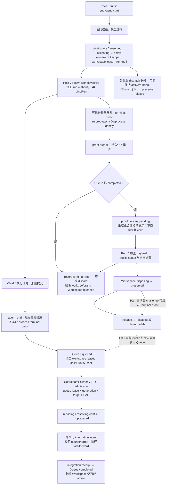

# Managed worktree 与 merge queue 整体审查（2026-10-17）

- Reviewer run：`bc43766e-88a6-451c-b7c5-21a69cbb61be`。
- 审查基线：`92b03021b52959237c2642560435cb8fd0528728`。
- 性质：用户明确授权的只读成果审查；以下保留 reviewer 返回原文。主会话已静态复核三个 High 的关键源码，但尚未运行真实删除/队列复现，也未实施修复。
- 来源：`.pi/subagents/artifacts/bc43766e-88a6-451c-b7c5-21a69cbb61be_reviewer_output.md`；该 artifact 是运行时报告，不读取 session transcript。

审查基线为 `92b03021b52959237c2642560435cb8fd0528728`。本次确认 **3 项 High，没有证据充分的 Blocker**。结论来自真实源码、已安装 Host 实现及既有测试断言的静态交叉核对；没有运行创建、变更或处置 managed workspace 的测试，也没有调用真实 provider、修改文件或读取受限运行状态。

图中 Root owner、coordinator daemon owner、workspace lease、queue lease/generation 是不同身份边界。`agent_end`、任务完成通知、queue completed 和 process terminal proof 也不能互相替代。

**H1 · High：合法 Responses tool-call ID 被直接当作受限 intent ID，导致 supervisor reply/steer 在投递前失败。**

- **路径与证据：** 已安装 Host 在 [openai-responses-shared.js](/Users/leshi.zhy/pi-config/node_modules/@earendil-works/pi-ai/dist/api/openai-responses-shared.js:369) 将 function-call ID 构造成 `${item.call_id}|${item.id}`；custom tool 同样如此。随后 [agent-loop.js](/Users/leshi.zhy/pi-config/node_modules/@earendil-works/pi-agent-core/dist/agent-loop.js:572)、[tool-definition-wrapper.js](/Users/leshi.zhy/pi-config/node_modules/@earendil-works/pi-coding-agent/dist/core/tools/tool-definition-wrapper.js:12) 和 [supervisor-operation-tools.ts](/Users/leshi.zhy/pi-config/packages/pi-subagents-enhanced/src/subagent-dispatch/supervisor-operation-tools.ts:181) 原样传递该 ID。
- **触发与首个偏离点：** 使用 Responses 路径的 Root，对真实、已登记的 pending request 调用合法 reply。[extension.ts:1590](/Users/leshi.zhy/pi-config/packages/pi-subagents-enhanced/src/subagent-dispatch/extension.ts:1590) 将 Host toolCallId 直接写成 `intentId`；[supervisor-control-plane.ts:54](/Users/leshi.zhy/pi-config/packages/pi-subagents-enhanced/src/subagent-dispatch/supervisor-control-plane.ts:54) 的安全 ID 规则不接受 `|`，在第 289 行返回 `SUPERVISOR_INTENT_INVALID`。此时尚未进入 native sender。steer 在 [extension.ts:1501](/Users/leshi.zhy/pi-config/packages/pi-subagents-enhanced/src/subagent-dispatch/extension.ts:1501) 存在相同转换。
- **身份与顺序：** requestId、runId、root、owner/request generation 即使全部正确，也会先被 intent parser 拒绝。下划线 `_` 合法；真实冲突字符是 `|`。
- **影响：** 受影响 provider 下，正常 supervisor 决策回复和 steer 无法完成；重复同类调用不能解决。interrupt/resume 可能成为任务恢复手段，但不能替代对原 pending request 的正常回复。
- **证据分类与覆盖：** 属于已安装生产实现之间的确定性合同不兼容；尚不能断言用户此前某次失败一定使用此 provider。仅用 `call-1` 等安全 ID 的 adapter/parser 测试覆盖不到该链路。
- **建议与最小 owner：** 由 dispatch/supervisor adapter 在 Host opaque ID → 内部 intent identity 的边界做稳定、无碰撞的编码或摘要，保持重放语义；保留原始 Host ID，不为此改写消息或放宽所有身份字段的安全规则。验证需覆盖 Responses 复合 ID、重复投递及 native sender 调用次数。

**H2 · High：public preserve → release 可以在 bound child 没有 terminal proof 时删除其工作区。**

- **路径与证据：** [service.ts:414](/Users/leshi.zhy/pi-config/packages/pi-subagents-enhanced/src/workspace/service.ts:414) 在 proof pending 时仍返回 `preserve`；合法 dispose 会消费 challenge，并将 workspace 置为 preserved。[tool.ts:97](/Users/leshi.zhy/pi-config/packages/pi-subagents-enhanced/src/workspace/tool.ts:97) 的 public release 不携带 proof/token。
- **触发步骤：** 对同 root 下已 bindRun、仍运行或暂停且 Git 工作区干净的 child，依次执行 public status、使用新鲜 token 的 dispose(preserve)、public release。
- **首个偏离点：** [service.ts:628](/Users/leshi.zhy/pi-config/packages/pi-subagents-enhanced/src/workspace/service.ts:628) 将 `challenge.used === true` 视作 legacy release 放行条件。前一步 preserve 恰好满足它，即使 workspace 已绑定 run、从未观察到终局证明也会放行。
- **身份、时间与资源顺序：** owner scope 和 action token 都可以正确；问题发生在消费 preserve challenge 后、进程仍存活期间。release 随后调用 [git-worktree.ts:475](/Users/leshi.zhy/pi-config/packages/pi-subagents-enhanced/src/workspace/git-worktree.ts:475)，执行 `git worktree remove`，再删除 managed branch。干净状态不是进程已退出的证明。
- **影响：** 能回收仍被 child 使用的目录和分支，破坏执行与集成链路。若存在未发布的干净提交，删除分支也会移除其正常引用。Git 对 dirty worktree 的拒绝只能挡住部分现场。
- **证据分类与覆盖：** 完整合法公共调用链的源码证明，未实际执行删除。[workspace-operation-tools.test.mjs:303](/Users/leshi.zhy/pi-config/test/workspace-operation-tools.test.mjs:303) 验证的是没有已消费 preserve challenge 的 cleanup-debt，不能覆盖此绕行；unbound orphan 的 preserve→release 测试也不能证明 bound run 安全。
- **建议与最小 owner：** 由 workspace service 的 release 权威统一校验：bound workspace 必须具有匹配 run/root/asyncDir 的可信 terminal proof；已消费 challenge 不能代替 proof。保留 unbound allocation orphan 的合法清理能力。public tool 可以内部取得授权，不能仅靠给 schema 增加 token 字段修复。

**H3 · High：public workspace 处置与 queue 终结脱钩，空交付工作区回收后仍可长期阻塞整个仓库队列。**

- **路径与证据：** [coordinator-server.ts:151](/Users/leshi.zhy/pi-config/packages/pi-subagents-enhanced/src/workspace/coordinator-server.ts:151) 的 prepare 会为尚无新增提交的 child 建立 queued item；[service.ts:287](/Users/leshi.zhy/pi-config/packages/pi-subagents-enhanced/src/workspace/service.ts:287) 随后因 `hasCommits === false` 拒绝 admission。终局 proof 到达后，[coordinator-server.ts:285](/Users/leshi.zhy/pi-config/packages/pi-subagents-enhanced/src/workspace/coordinator-server.ts:285) 只生成 resume/handoff intent，保留 queue pending。
- **触发步骤：** child 无需修改文件或失败后无 payload，在 agent_end 入队、最终进程退出；Root 根据可信 proof 和 public status 合法 discard，或 preserve 后 release。随后另一 child 向同仓库排队。
- **首个偏离点：** public dispose/release 只进入 workspace service。生产 Root 在 [subagent-runtime.ts:385](/Users/leshi.zhy/pi-config/packages/pi-subagents-enhanced/extensions/subagent-runtime.ts:385) 绑定的是本地 service；[tool.ts:90](/Users/leshi.zhy/pi-config/packages/pi-subagents-enhanced/src/workspace/tool.ts:90) 的处置没有同时取消或保留对应 queue item。因此 workspace 已 released，而原 queue item 仍 queued。
- **身份与资源顺序：** 原 queue item 仍持有旧 workspace lease、childRunId 和 owner root；worktree 已被合法删除，新 child 拥有另一套身份。队首判断在 [coordinator-server.ts:76](/Users/leshi.zhy/pi-config/packages/pi-subagents-enhanced/src/workspace/coordinator-server.ts:76) 只跳过 completed/cancelled/preserved，后续 item 因旧队首存在返回 null。
- **影响：** 故障从一个无交付 child 扩大到同仓库其他 root 的集成。再次发送 proof、重新启动 coordinator 或完成 public release 都不能自动关闭该 queued item。
- **替代路径核实：** coordinator 的 `preserveIntegrationDebt` 可以同时处理 queue/workspace，但 public dispose/release 未调用它。`reconcileIntegrations` 只作为 internal 方法导出；本次源码搜索未发现生产调用，listen 只重放 proof 和 handoff。手工通知也没有改变 queue 状态。不能用“存在内部恢复函数”认定公共处置已收敛。
- **证据分类与覆盖：** 生产调用链和状态写入范围的源码证明，未运行真实队列复现。已有 queue completed、receipt 或单 workspace released 断言都不足；缺少“空交付队首 → public 回收 → 后继跨 root 成功 admission”的组合覆盖。
- **建议与最小 owner：** 由 coordinator 负责将公共处置与对应 queue item 的终结绑定，以 workspace lease/run/generation 校验，并具备持久化 intent 和崩溃重放。无 payload 应成为明确可终结结果，不能要求空提交或绕过 child-owned 发布规则。

五类指定现象的结论如下：

| 现象 | 核实结果 |
|---|---|
| schema / strategy | 新 factory 的 strategy 可选；非 integrate 携带 strategy 会被原 runtime guard 拒绝。不能据一次失败认定 schema 强制 strategy。真实 provider 投影是否改变 required/nullability 仍未知。 |
| supervisor reply invalid | H1 已证明合法 Responses ID 可在本地 parser 被拒绝；不是 pending request 缺失，也不是 native sender 故障。具体历史失败是否同因仍需当次非敏感诊断。 |
| 空 worktree handoff | 无新增提交不会完成 admission，终局 proof 也不自动等价于 queue completed。handoff 文案要求检查提交并不能证明存在 payload；实际高风险是 H3 的处置后队列残留。 |
| origin-dirty | [git-worktree.ts:466](/Users/leshi.zhy/pi-config/packages/pi-subagents-enhanced/src/workspace/git-worktree.ts:466) 和第 606 行明确阻止 dirty canonical checkout admission/fast-forward；未发现可据此认定的父 dirty 覆盖缺陷。不能把该 guard 当作所有处置都被禁止。 |
| child-owned publication / 主会话接管 | 父层 integrate 返回 `CHILD_OWNS_INTEGRATION` 是明确权威边界。接管通知不授予 raw merge/cherry-pick 权限，也不提供已完成的 queue 终结。修复应保留该边界。 |

边界审查还确认：queue lease/generation、workspace token/snapshot 和身份检查能拒绝多类陈旧或重放操作；正常 queue completed 后存在 proof outbox → discard → released 的可信路径，不能报告“没有自动回收”。部分 publish 的 Git 层允许 target 已等于 candidate 的幂等恢复，receipt 也有身份核对；但恢复函数存在不等于死亡后必然被生产调度。

分配后 ping/授权失败确实可留下 active、run=null 的 workspace，失败返回不携带 workspace identity。既有测试明确断言这种保留；同 root 存在 list→preserve→release 出口，因此没有把“每次分配失败都不可恢复”作为额外 High。Root 死亡后的跨 scope 发现和恢复，以及 cleanup-debt 的管理员授权路径，仍需专项证据，不能用 run stop 断言替代资源回收断言。

修复优先级建议为 **H2 → H3 → H1**：先关闭活进程资源回收漏洞，再闭合跨状态机处置，最后修复 provider ID 转换。H1 可独立并行；H2 与 H3 应共享 workspace disposition 合同并协调修改，避免一侧加强 proof 后另一侧仍留下 queue。

后续验证所需的最小证据是：

- H1：provider/API 名、脱敏后的 ID 字符结构、parser 错误码、native sender 是否进入；无需 session 正文或凭据。
- H2：相同 run 的 pending/observed proof、preserve challenge 消费状态、release 前后资源存在性；必须同时覆盖 bound 与 unbound。
- H3：两个 queue item 的状态序列、workspace lease/run 对应关系、公共处置回执及后继 admission；同时覆盖 no-change、failed、origin-dirty 后终止和 coordinator 重启。

以上是修复边界与证据要求，没有编写实施计划。最终检查未见暂存文件；原 dirty 文件保持原状，审阅期间出现的新增未跟踪记录目录没有打开或改动。
